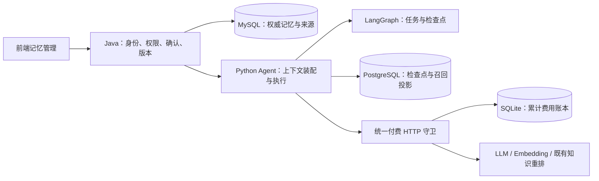
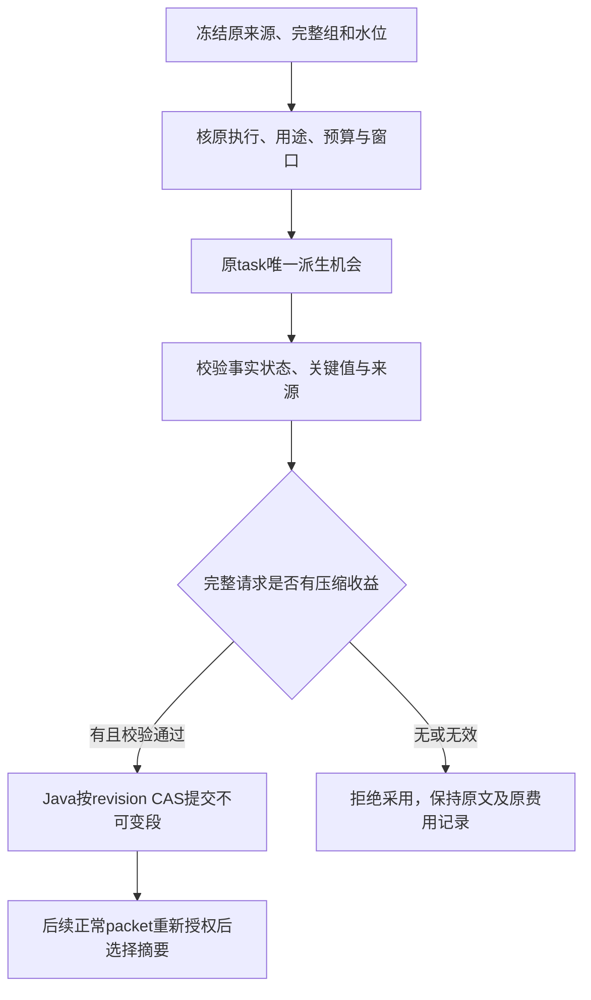

# Agent记忆系统实现逻辑与技术选型

| 属性 | 内容 |
| --- | --- |
| 文档类型 | 当前实现复盘与技术说明 |
| 状态 | 支持范围已实现；新增能力默认关闭，未完成生产发布验收 |
| 负责人 | Codex |
| 更新时间 | 2026-11-19，北京时间 |
| 适用范围 | 通用对话、运营及11个专家、智能客服、HR当前任务事实处理 |
| 依据 | 当前源码、实施记录和实际验证结果；本文不替代发布策略、执行授权或数据库迁移审批 |

## 1. 系统目标与总体架构

记忆系统在现有平台内实现，统一管理记忆的来源、确认、使用范围、上下文窗口、费用和删除生命周期。

Java负责身份权限、业务事实、记忆确认、版本和持久化提交；Python Agent负责受控上下文装配、摘要与候选生成、索引及召回。模型只能提出候选，不能自行确认事实、扩大权限或发布规则。



工程边界：

- 前端调用Java，Java通过`AiInvokeFacade`单向调用Agent。
- Python不反调Java，也不直接写Java业务表。
- LangGraph是唯一Graph运行时。
- 当前数据库事实、正式知识和岗位评分规则保持原有权威地位。
- 记忆作为受控输入使用，不代替业务执行授权。

## 2. 记忆分层与作用范围

| 记忆类型 | 内容 | 主要隔离范围 | 使用方式 |
| --- | --- | --- | --- |
| 工作记忆 | 当前计划、任务进度、工具回执、恢复引用 | 租户、用户、task、execution | 当前执行与受控恢复 |
| 短期记忆 | 会话消息、近期完整组、分段摘要 | 租户、用户、业务域、顶层Agent、会话 | 当前会话连续理解 |
| 语义记忆 | 用户已确认的语言、详略、格式等偏好 | 租户、用户、顶层Agent、字段 | 同Agent跨会话使用；精确读取优先 |
| 情景记忆 | 措施、观察结果、证据、适用条件和禁用条件 | 所有者、来源及批准的共享范围 | 经人工确认后复用 |
| 程序经验晋升 | 已审核案例形成正式资产候选 | 原案例、审批人、回归证明、资产版本 | 沿既有Prompt、Skill、Workflow管理路径推进 |

同一用户使用运营助手和客服时，默认各自拥有私有记忆。会话摘要不自动跨会话或跨Agent共享。

跨Agent偏好需要显式授权，字段范围限定为回复语言、详细程度和格式。共享范围有自己的ACL、成员接受、审批、有效期和撤回规则；获得记忆共享权限不等于获得原业务对象访问权限。

运营专家接收父任务实际分配的目标、条件和上游结果切片，继承这些内容的真实传递来源，不自动获得父任务全部历史正文。授权包里存在某个来源，不代表专家实际使用过它。

HR采用`TASK_ONLY`，只处理当前候选事实、岗位规则、配置和评估日期；不建立候选人长期印象，不将用户界面偏好带入评分。

## 3. 核心数据对象与三个生命周期

| 对象 | 职责 |
| --- | --- |
| `MemoryPolicy` | 已发布的字段、用途、Agent范围、来源类型、保留和付费能力策略 |
| `MemoryContextPacket` | Java为原任务签发的记忆及来源授权包 |
| `MemoryExecutionContext` | 原授权包、执行grant、截止、指纹及必要的冻结投影 |
| `ContextManifest` | 最终请求实际采用的来源、模型与资产版本、计窗结果及摘要状态 |
| Summary Plan / Segment | 冻结来源与水位、唯一派生计划、不可变已提交摘要段 |
| Proposal / Decision / Version | 候选、人工决定与权威记忆版本 |
| Index Job / Query Operation | 索引写入和查询Embedding的持久操作与去重机会 |
| Tombstone / Suppression / Outbox | 防复活锚点、停止再学习规则和可靠生命周期事件 |

系统分别管理业务任务、一次执行和付费授权：

- `task_id`表示同一个业务目标，累计费用和次数跨执行保持。
- `execution/run`表示一次有绝对截止的执行窗口，旧执行过期后不复活。
- 后继授权由本机管理命令显式创建，只消费原task剩余额度。
- Checkpoint保存恢复状态，不授予新的业务权限或付费额度。
- 来源数据保留期与一次付费发送截止分别管理，长期索引不会因为请求窗口结束而立即失效。

## 4. 记忆写入：明确设置、候选与确认

### 4.1 用户明确设置

用户选择受支持的偏好字段和值，Java重新核验身份、发布策略、范围、抑制状态和预期版本，然后在数据库事务中保存决定与新版本。此过程不调用模型。

首次创建依赖逻辑唯一键避免出现两个同字段有效记录；更新使用预期revision比较，冲突返回409，不能静默覆盖。

### 4.2 模型提出候选

候选生成前冻结合法来源、用途、完整依赖和原任务授权，生成后由代码重新校验。

| 分类 | 含义 |
| --- | --- |
| `ADD` | 建议新增 |
| `REPLACE_CANDIDATE` | 明确目标下的替换候选，仍需确认 |
| `CONFLICT_CANDIDATE` | 与现值或其他来源存在冲突，不能按最新一句话盲覆盖 |
| `NOOP` | 已存在等值内容，无需变化 |

每次最多16条候选，单条不超过512 tokens计数上界。去重先采用CPU处理；模型不能填写确认人、租户或共享权限来制造权威。

### 4.3 次日确认

用户第二天确认候选时，Java重新核验当前来源、权限、抑制与版本。原执行预算过期不妨碍合法的CPU确认保存。

确认成功后状态与索引状态分别表达：已保存、可以按字段使用，但索引仍为`NOT_REQUESTED`。确认和GET均不会自动触发Embedding。

## 5. 问答读取与上下文装配

一次问答按以下顺序处理：

1. Java从真实身份和业务归属确定当前用户、Agent、会话和用途。
2. Java核验发布策略，签发原任务的`MemoryContextPacket`，绑定字段、版本、依赖和截止。
3. Agent保留当前问题、系统规则、正式事实和必要证据，选择近期完整消息组、合法摘要与偏好。
4. 检索结果经Java再次鉴权和当前来源核验后才读取正文。
5. 对最终完整Provider请求重新计窗，形成实际来源`ContextManifest`。
6. 通过原运行控制器和付费HTTP守卫后发送。

“允许读取的来源”和“实际使用的来源”分别记录。实际使用来源决定回答、摘要和上游结果的传递依赖，不能按展示引用缩小依赖。

## 6. 上下文窗口、分段摘要与压缩

### 6.1 完整请求计数

每个发布模型绑定上下文容量、节点输入上限、输出预留、安全余量与序列化口径。

当前使用本地UTF-8序列化的保守token上界，覆盖消息、角色包装、工具参数和相关请求开销。它是发送前的容量保护，不等于供应商返回的实际usage；系统不通过额外远程计数请求消耗费用。

压力按70%和85%分级处理。工具或专家输出只有存在可验证增长上界时才参与预测；未知增长标记为未知，物化后仍重新测量完整请求，不把预测当实际usage。

### 6.2 摘要硬限制

| 项目 | 当前上限 |
| --- | --- |
| 摘要来源输入 | 2000 tokens保守上界 |
| 单段摘要 | 500 tokens保守上界 |
| 一次注入的摘要总量 | 1000 tokens保守上界 |
| 一次采用的摘要段数 | 最多3段 |

摘要结构保留目标、已确认约束、决策、否决项与原因、开放问题、重要引用和不确定内容。每项携带内容来源与决定状态，模型建议不会通过摘要升级成用户确认。

### 6.3 生成与提交



摘要期间允许水位外追加新消息；覆盖区间内更正、遗忘或确认状态变化会使旧候选失效。CAS保证并发提交不会互相覆盖。

近期原文保护优先，已采用摘要与近期完整组不重复覆盖。首次压缩必须证明完整`T_after < T_before`；后续问答补入已压缩的更旧信息可能增加输入量，只要窗口合法，不将这种增加宣传为再次压缩收益。

### 6.4 紧凑投影与客服JSON

模型文本使用短引用，完整UUID、版本、epoch、权限和分组信息留在可信元数据中。短引用只能指向原冻结来源；未知引用、篡改确认和不合法关键值会被拒绝。摘要解释legend进入完整请求计数，不隐藏其开销。

`SUMMARY`采用匹配的`derive-prompt/2`、`derive-schema/2`；`PROPOSALS/BOTH`采用匹配的`/3`紧凑协议。摘要和候选共用原task一次派生机会，不能因用途分开再发第二次生成。

客服普通回答使用受信JSON历史投影，只重建同一个`history`数组，保留当前问题、intent、其他事实字段、系统消息和Schema。只有满足完整来源、消息组和普通对话准入条件的历史可压缩；知识证据、工具事实和HR评分材料不能被这条叙述压缩路径有损改写。

## 7. 混合检索、RRF与BM25的实际状态

### 7.1 两条检索链

| 技术 | Agent记忆召回 | 客服知识库检索 |
| --- | --- | --- |
| 向量召回 | 合法集合内精确余弦相似度 | pgvector向量检索 |
| 词法召回 | 查询词与已存词项的集合交集数量评分 | PostgreSQL全文检索，使用`ts_rank_cd` |
| 混合检索 | 已实现向量与词项双路候选 | 已实现向量与全文双路候选 |
| RRF融合 | 已实现，常数60，最终最多8条 | 已实现，常数60 |
| 模型Rerank | 当前记忆链未接入 | 既有知识链已接入受控重排 |
| BM25 | 未实现 | 未实现 |

混合检索表示多种检索方式共同召回；RRF负责融合各路名次；BM25是一种词法相关性评分算法。三者职责不同。

当前记忆侧的词项匹配、知识侧的PostgreSQL全文排序，均不能称为BM25。现有实现没有完整BM25的词频饱和、逆文档频率和文档长度归一化评分；RRF也不能替代这些评分能力。

### 7.2 Agent记忆召回

```text
Java当前合法集合
  → 向量余弦排序 + 词项匹配排序
  → 各路最多30条
  → RRF融合，最终最多8条
  → Java按当前权限、来源和版本再次取正文
  → 受上下文注入预算限制
```

合法集合限定在10000条以内。SQL先按完整作用域、item、version、generation、删除epoch和来源指纹过滤，再读取合法向量进行精确排序，不先全库取正文后过滤。

新增记忆索引首版使用PostgreSQL保存向量、有限词项与引用，向量以JSON文本形式存储，代码执行精确余弦计算，未启用ANN近似索引。项目既有知识检索使用pgvector，二者不能混称同一索引实现。

不提供查询向量时可以仅走词项召回。请求查询Embedding必须满足原task有限授权、真实价格和独立持久操作机会。候选不足允许少返回，不扩大scope补足数量。

### 7.3 RRF计算

对同一候选，累加各路排名贡献：

```text
RRF(d) = Σ 1 / (60 + rank_i(d))
```

RRF融合排名，不直接相加不同检索器的原始分数。记忆召回最终返回引用和融合分数，Java再次核验后读取正文。

### 7.4 客服知识检索

```text
已发布知识范围与逐文档授权目录
  → 查询处理
  → pgvector向量召回 + PostgreSQL全文召回
  → 去重与RRF融合
  → 受控Rerank
  → 证据装配、冲突与充分性处理
  → 回答与引用
```

Java通过知识模块Facade获取当前租户、身份权限和已发布目录，逐项绑定文档版本及文件SHA。Agent检索到的证据必须匹配该目录、成员文件SHA与正文hash；release ID本身不能代替逐文档授权。

## 8. 索引生命周期与持久去重

索引建立需要独立明确请求，不由候选确认自动触发。当前首版单条投影视作一个有界写索引批次，同task只获得一次写索引机会；查询Embedding另有一次持久机会。

索引与查询操作保存稳定指纹和状态：

- 同内容且`READY`的重放复用结果，不再次调用Embedding。
- 改内容、改范围或改模型空间不能借原机会重新请求。
- `INFLIGHT/UNKNOWN`跨进程和执行保留，不自动重新发送。
- 删除epoch和generation防止迟到写入恢复旧数据。
- 旧generation删除不会误删同epoch下较新的有效generation。
- 模型、向量维度、发布策略和作用范围共同隔离索引空间。

索引数据保留期与发送截止分开。后台有界CPU清理会实际删除到期向量与词项，并清除到期QUERY向量及引用；费用槽、指纹、必要墓碑和未决状态继续保留，避免清理产生新的付费机会。关闭新生成或召回不取消已装配的独立清理能力。

## 9. 来源血缘、撤权与遗忘

每个派生对象记录完整依赖，例如：

```text
用户偏好 → 助手回答 → 会话摘要 → 经验案例
```

如果模型实际使用A和B，即使最终只展示B的引用，仍保留对A的依赖。

更正、撤权或遗忘按以下顺序处理：

1. Java先禁用相关读取，推进授权、来源和删除epoch。
2. 沿反向依赖禁用历史模型投影、摘要、候选、案例和索引。
3. 使用同事务Outbox可靠投递停止、技术快照清理、检查点清理和索引删除。
4. 按事件、对象、generation和epoch校验精确回执。
5. 取得所需清理证明后，才确认对应目标完成。

Tombstone保存防复活锚点；Suppression保存字段或来源的停止再学习规则。换策略、换item ID或重启进程不能绕过抑制。

遗忘不清零财务账本。备份恢复先应用删除清单、抑制与财务记录，再开放正文和恢复入口。索引有持久Job时必须取得真实删除回执，不能仅凭当前开关关闭或搜索无结果声称已清理。

## 10. 共享案例与正式资产晋升

跨Agent偏好只共享被批准的白名单字段，原私有值保留。撤回目标授权只撤该投影，退出共享范围只撤当前成员的投影。

案例保存场景、前置条件、措施、观察结果、分母与时间、证据、适用版本和禁用条件。点赞只表示用户偏好，不证明效果正确。

晋升流程：

```text
案例候选
  → 人工确认
  → 所有者人工脱敏并申请共享
  → 独立审批人批准
  → 正式资产草稿
  → 独立人员核验固定回归证明
  → 另一位有权人员批准发布
  → 沿既有发布管理部署
```

回归证明绑定固定套件、候选digest、报告SHA和通过数量，不能由模型自报通过。正式资产回滚也要复验精确历史资产与当前来源，不能恢复已撤回内容。

Workflow/Skill候选批准后与既有发布器状态衔接，部署ACK后再推进运行资产状态。批准发布、版本状态和远端实际部署分别表达，不因HTTP成功就声称已上线。

## 11. 费用、Token与循环调用保护

所有生成、摘要、候选提炼、Embedding和付费重排都经统一`PaidHttpTransport`，复用当前用户固定SQLite总账。

| 约束 | 当前规则 |
| --- | --- |
| task累计金额 | 默认100元或原更严格上限，跨执行和后继授权累计 |
| task累计HTTP次数 | 默认60次或原更严格上限 |
| 单个逻辑操作尝试 | 最多3次累计 |
| 单次执行窗口 | 最长10分钟，等待不暂停绝对截止 |
| 摘要与候选生成 | 共用原task唯一派生机会 |
| 写索引与查询Embedding | 各有独立持久机会，不能换event或execution重领 |
| 未知结果 | 保留预留额度与状态，不自动退款或重发 |
| 402 | 立即持久熔断 |
| 429 | 累计达到阈值后持久熔断 |

发送前核验价格上界、模型、调用数、金额以及输入、输出、推理Token限制；按保守工作量预留，返回后按供应商usage结算。缓存输入和推理Token按既有计费子集口径处理，避免重复计算。

100元是同业务task累计上限，不表示每个子Agent、每轮问答或新run都重新获得100元。新run、重启、换进程、换工作树不能重置账本。

后继授权只能通过本机管理命令显式创建，无确认参数时只读预览。业务HTTP和模型输出不能创建、续期或扩大预算。

## 12. 技术选型与实际用途

| 技术 | 用途与边界 |
| --- | --- |
| Java 21、Spring Boot | 权威记忆服务、身份、确认、审批、版本和业务接口 |
| MyBatis / MyBatis-Plus | 关系表与来源映射，配合明确SQL执行事务操作 |
| MySQL、行锁、唯一约束、CAS、触发器、Outbox | 并发一致性、不可变版本、失效传播和可靠事件 |
| Python 3.13、FastAPI、Pydantic | Agent内部接口、严格合同、结构化输出与校验 |
| LangGraph、PostgreSQL Checkpointer | 唯一Graph执行与检查点保存、恢复 |
| PostgreSQL、psycopg | 记忆索引、查询去重、删除水位和到期清理 |
| pgvector | 既有客服知识向量检索；新增记忆索引首版采用有界精确计算 |
| Embedding | 索引和查询向量；当前适配DashScope OpenAI兼容接口的text-embedding-v4、1024维 |
| 精确余弦、词项匹配、全文检索、RRF | 有限范围内的混合召回；BM25尚未实现 |
| SQLite事务 | 固定费用总账、跨授权task累计和原子额度争用 |
| HTTPX、受控Provider、OpenAI兼容客户端 | 唯一外部发送边界，不绕过费用守卫 |
| AES-256-GCM与AAD | 正文、授权快照及检查点加密，绑定租户、对象、执行或物理位置 |
| SHA-256、HMAC | 内容指纹、来源版本、请求绑定及完整性校验 |
| Vue 3、TypeScript、Ant Design Vue、Zod | 候选确认、共享审批、摘要、来源省略和费用状态界面 |
| JUnit、ArchUnit、pytest、Vitest、Ruff、mypy | 行为、跨端合同、架构依赖、类型和静态检查 |

项目既有Redis等运行设施不承担记忆权威正文、确认事实或费用总账的职责。本轮没有另外部署独立记忆产品、图数据库或ANN向量集群。

## 13. 开源方案借鉴

| 项目 | 借鉴机制 | 实际采用方式 |
| --- | --- | --- |
| LangGraph | Checkpoint与长期记忆职责分离 | 实际沿用唯一运行时和持久检查点 |
| LangMem | 语义、情景、程序性记忆与候选处理 | 借鉴设计，不默认使用其自动模型调用链 |
| Mem0 | 候选提炼、去重、变更与检索接口 | 平台内实现受控版本和权限逻辑 |
| Letta | 少量常驻核心内容与按需召回 | 借鉴分层，不引入第二Harness或自动自改规则 |
| Graphiti | 事实时效、关系与冲突处理 | 使用现有关系表与来源生命周期，不部署图数据库 |
| Hindsight | 记录、召回、复盘分工 | 复盘受独立预算和审批约束，不开启自动反思循环 |
| MemOS | 记忆管理、生命周期和多Agent隔离 | 在现有Java治理与前端中实现 |

除实际沿用的LangGraph外，上述项目主要作为机制参考，没有整套接入其自动记忆SDK或默认云服务。

## 14. 实际验证与发布边界

截至2026-11-19，本阶段已有以下证据：

- 714项相关定向测试和47项子测试同次通过，耗时30.34秒。
- 72个本轮生产Python文件的Ruff、mypy及编译检查通过。
- 前端21项定向检查、类型检查、lint和构建通过。
- 真实Java→Agent→MySQL/PostgreSQL→PaidHttp(MockTransport)→密文摘要CAS→完成回执→后续正常packet采用摘要链通过；仅1次请求、1次尝试。
- 上述链中后续完整输入9275不超过12000，摘要424不超过单段500；真实供应商调用为0。
- 真实MVC、身份与MySQL验证了原执行过期后的CPU候选确认、跨Agent授权和撤回保留原私有值。
- 原生PostgreSQL验证了索引与QUERY去重、保留期、乱序删除、防复活及实际到期擦除。
- MySQL新12张表及V1.2.24知识事件迁移完成隔离安装、未使用状态逆序回滚和重装验证。
- 集中独立评审发现的1项Critical和4项Important已修复，并完成原问题的独立静态复核。

这些结果证明对应工程与安全边界，不证明真实模型的摘要语义、Recall@8或性能指标已经达标。

仍需明确保留的边界：

1. 新能力默认关闭，尚未完成生产共享数据库部署；共享MySQL的trigger 1419问题未通过修改全局参数绕过。
2. 当前验证的模型边界采用Fake/MockTransport，未执行真实付费模型语义验收。
3. 客服新增知识与自动摘要代码、定向检查及同版Java编译已通过，未额外执行这两条完整原生跨端业务链，不能用运营摘要链代替全部客服验收。
4. 外部Identity部门或角色变化尚无push事件接口；当前每次签包、恢复和发布复验权限，不声称所有外部权限变化都已主动广播取消旧流。
5. HR缺少可信测量或去身份技术事件权威时明确拒绝，不由模型制造事实证明。
6. 行政Agent尚未实现。
7. 300题、1000作用域全量评测未运行，不填写未经测量的语义质量或延迟承诺。

## 15. 关键代码与记录入口

下列路径相对项目根目录：

| 主题 | 主要位置 |
| --- | --- |
| Java记忆服务 | `ai-efficiency-platform/aiep-biz-aihub/src/main/java/com/aiep/aihub/application/memory/` |
| Java跨端合同 | `ai-efficiency-platform/aiep-platform-ai/src/main/java/com/aiep/platformai/api/dto/` |
| Agent记忆与上下文 | `efficiency-platform-agent/src/efficiency_platform_agent/memory/`、`context/` |
| 实际组合与原运行绑定 | `efficiency-platform-agent/src/efficiency_platform_agent/harness/` |
| 记忆索引与持久化 | `efficiency-platform-agent/src/efficiency_platform_agent/persistence/memory_index.py` |
| 记忆RRF | `efficiency-platform-agent/src/efficiency_platform_agent/memory/ranking.py` |
| 客服混合检索与RRF | `efficiency-platform-agent/src/efficiency_platform_agent/agents/customer_service/retrieval.py` |
| 客服向量与全文SQL | `efficiency-platform-agent/src/efficiency_platform_agent/agents/customer_service/vector_repository.py` |
| 前端管理 | `ai-efficiency-platform-ui/src/features/memory-context/`、`memory-proposals/`、`memory-sharing/` |
| Java迁移 | `ai-efficiency-platform/sql/` |
| Agent索引迁移 | `efficiency-platform-agent/sql/bootstrap/memory_index_v1/` |

关联文档：

- [Agent记忆与上下文边界ADR](Agent记忆与上下文边界ADR.md)
- [Agent统一记忆系统交付与验收记录](../verification/Agent统一记忆系统交付与验收记录.md)
- [Agent分段摘要与压缩验收记录](../verification/Agent分段摘要与压缩验收记录.md)
- [Agent记忆部署恢复与预算操作说明](../operations/Agent记忆部署恢复与预算操作说明.md)
- 本阶段原始检查汇总：`.local-acceptance/agent-memory-implementation/green/M3-final-delivery-checks.json`。
