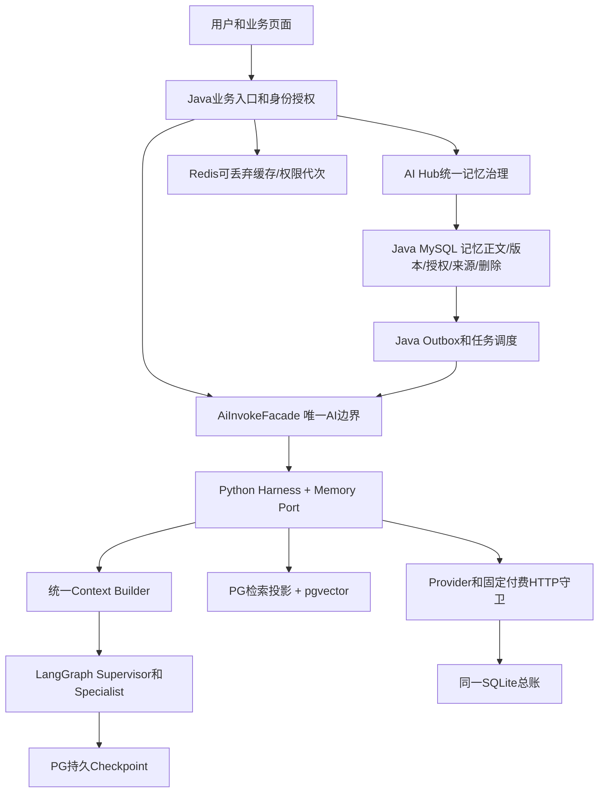

# 全项目Agent统一记忆系统设计方案

| 属性 | 内容 |
| --- | --- |
| 状态 | R4参考方案整合提案；保留R2记忆协议，独立上下文协议待共同复评；未冻结实施、未改生产代码/数据库 |
| 负责人 | Codex，项目负责人评审 |
| 调研与设计日期 | 2026-11-13，北京时间；R4合入外部参考方案有效增量并拆分协议；R1—R3留历史快照 |
| 范围 | 通用对话、运营Supervisor及11个Specialist、智能客服、HR全部Skill，以及未来行政Agent |
| 原则 | LangGraph唯一运行时、Java业务与权限真相源、单向Java→Agent、统一费用守卫、可追溯与可删除 |
| 关联基线 | [Agent总体架构](../../../efficiency-platform-agent/docs/architecture/纯Agent侧总体架构.md)、[四层记忆基线](../../../efficiency-platform-agent/docs/superpowers/specs/2026-09-02-Agent侧P0-P5总体技术架构-设计.md)、[ADR-0005](../../../efficiency-platform-agent/docs/adr/ADR-0005-Agent运行态使用MySQL.md)、[Java架构](../../../ai-efficiency-platform/docs/architecture/Java端架构与开发约束.md)、[付费规范](../../../AGENTS.md) |

## 1. 推荐结论与目标

推荐在现有平台内建立统一Memory能力，使用现有MySQL、PostgreSQL/pgvector、Redis和LangGraph，借鉴优秀开源项目的机制，不整套引入独立记忆服务或第二套Agent运行时。全量目标按后续阶段保留，首期先交付M1-A每次模型调用的上下文控制，再交付M1-B用户私有结构化偏好的保存、跨会话读取、更正和忘记闭环。

所有Agent使用统一的记忆契约、权限和生命周期，但不共享一个任意读写的记忆池。实现目标是：当前任务能够恢复，同一会话能够连续理解，跨会话能记住用户明确确认的偏好和业务上下文，历史任务经验可经过审核后复用；事实变更、授权撤销、源数据删除后，旧记忆不继续污染回答。

同时满足：

- 每条长期记忆回答“谁说的、依据是什么、当时何时有效、现在是否仍可使用”。
- 用户能查看、更正、撤销和忘记记忆；可以关闭长期记忆而继续普通问答。
- 记忆是受控上下文，不是系统指令，不代替当前数据库业务事实、正式知识库、评分规则或执行授权。
- 记忆不会因“自动反思”“后台整理”“重试”造成无限模型调用或隐形费用。

## 2. 项目现状核对

本节区分源码现状与已批准设计，不以文档中的规划代替实际实现。

| 位置 | 当前事实 | 本方案处理 |
| --- | --- | --- |
| Agent `memory/__init__.py` | 只有记忆边界声明，没有统一读写、召回、确认、遗忘实现 | 建立统一Memory Port与策略实现 |
| `core/agent.py` | AgentSpec已有`memory_policy_id`，运营11个Specialist声明同一策略ID | 将ID落实为发布的可校验MemoryPolicy；不存在策略时不允许静默启用 |
| `context/builder.py` | 通用ContextBuilder只装配当前输入，当前估算为字符数/4 | 建立跨入口统一上下文预算；使用适配模型的tokenizer或已验证保守上界，不能继续把字符/4当中文硬预算 |
| `agents/conversation/general_agent.py` | 接收`visible_history`，拼当前消息和受控历史 | 复用Java授权历史，增加有来源的摘要/记忆包 |
| Java智能客服应用服务 | 已从Java持久历史取最多12条完成消息并有界传入Agent | 保留Java消息权威性，补摘要、用户偏好与来源失效逻辑 |
| `persistence/research_local_memory.py` | 单进程研究临时库，最长30分钟、最多100个Run；重启不恢复 | 继续作为研究临时缓存，不当成长期记忆 |
| `persistence/intent_state.py` | 有tenant/task隔离的意图状态与revision CAS | 保留为任务/意图状态，不自动提升为用户长期事实 |
| `orchestration/runtime.py` | 有Checkpoint接合点，也有进程内默认实现 | 正式记忆配置显式注入持久化，缺配置不宣称可恢复 |
| `orchestration/postgres_checkpoint.py` | 有自有Checkpoint适配器和官方AsyncPostgresSaver工厂 | 按实际Graph路径接合并真实重启验收，不能仅因类存在就称已全Agent启用 |
| ADR-0005 | Agent Run/Event运行事实使用独立MySQL；向量仍pgvector；Checkpoint迁移另议 | 不再按早期文档把所有运行事实统一搬PostgreSQL |
| HR | Java拥有授权、事实/配置/结果快照、保留删除；Python执行受控Skill | 不再复制一套候选人“印象库”或让历史记忆改评分 |

本轮只读取源码/公开资料并写设计及调研快照，没有调用模型、Embedding、rerank、数据库或业务写接口。

## 3. GitHub项目调研与可借鉴机制

实际读取了以下项目README、许可证及部分关键源码/官方概念文档。GitHub公共API返回403限流，因此未获取可靠的当前提交SHA、星数和版本；采用raw公开文件快照、获取时间和SHA-256留证。以下是机制比较，不是复现了各项目的性能宣传或完成安全审计。

| 项目 | 实际核对与可借鉴内容 | 本项目不直接照搬的部分 | 决策 |
| --- | --- | --- | --- |
| [LangGraph](https://github.com/langchain-ai/langgraph) | Checkpointer与长期Store分离；Store支持namespace、key、可选向量搜索和TTL；官方记忆文档区分thread短期与跨thread长期 | namespace自身不是企业权限；默认TTL刷新可能延长保留，不能用于HR法定/授权上限 | 沿用唯一运行时，使用持久Checkpoint；Memory Port可适配BaseStore，但不能直接暴露裸Store |
| [LangMem](https://github.com/langchain-ai/langmem) | Profile与Collection、语义/情景/程序性记忆、hot path与background写入、抽取与合并功能原语 | 示例让Agent自由调用记忆工具、自动优化Prompt；会产生额外模型调用 | 主要设计参照；首期实现窄适配器，依赖包是否采用需隔离PoC，不默认调用其内置模型 |
| [Mem0](https://github.com/mem0ai/mem0) | `add/search/update/delete`、user/agent/run过滤、推断更新与历史；源码有创建/更新/删除与Embedding路径 | 默认LLM/Embedding配置及SDK自动调用可能绕过本项目守卫；这些ID过滤不等于部门/用途/对象授权 | 借鉴受控候选抽取、去重与变更动作；不直接嵌入其自动执行链 |
| [Letta](https://github.com/letta-ai/letta)、[Letta Code](https://github.com/letta-ai/letta-code) | 当前Letta主README指向letta-code；现行README有memory blocks、MemFS、message search、反思；archive版Memory schema可见核心块/摘要/召回分层 | 自改系统Prompt/Skills/Harness、任意跨Agent搜索、云端默认及Git记忆库与本项目边界冲突；旧V1已退役，不能按旧教程部署 | 借鉴“少量常驻核心块+按需检索”；不引入新Harness、不上传GitHub或云记忆、不自动自改规则 |
| [Graphiti](https://github.com/getzep/graphiti) | 实体/关系/episode、事实有效时间与失效时间、历史保留；源码EntityEdge有`valid_at/invalid_at/expired_at` | 关系提取/去重可能多轮LLM；图数据库增加运维；参考server明确没有认证/授权/注入保护 | 借鉴双时间与冲突处理，首期用关系表；不部署参考server，不把group_id当权限 |
| [Hindsight](https://github.com/vectorize-io/hindsight) | retain/recall/reflect分工、world/experience等类型、带证据观察、混合召回、token预算和预计算页面 | retain和reflect会触发模型，后台consolidation也有成本；默认SDK包装不能替代统一Provider | 借鉴“记录/召回/复盘分开”，维护预计算记忆摘要；反思默认关闭 |
| [MemOS](https://github.com/MemTensor/MemOS) | 统一add/retrieve/manage、记忆生命周期、多Agent共享/隔离、图/工具经验与可管理视图 | 当前自托管路线包含Neo4j/Qdrant；本地插件与云插件不同，不能混称零外部依赖 | 借鉴治理控制台、生命周期和经验晋升；首期不引入第二组向量/图数据库 |

已读取的根许可证：LangGraph/LangMem/Hindsight为MIT；Mem0/Graphiti/MemOS/当前Letta Code为Apache-2.0。仅代表读取到的根许可证，不代表子包、模型权重、云服务条款相同；实际采用前锁定版本、核对NOTICE与传递依赖。

源码核对入口包括：[LangGraph BaseStore](https://github.com/langchain-ai/langgraph/blob/main/libs/checkpoint/langgraph/store/base/__init__.py)、[LangGraph AsyncPostgresSaver](https://github.com/langchain-ai/langgraph/blob/main/libs/checkpoint-postgres/langgraph/checkpoint/postgres/aio.py)、[LangMem概念](https://github.com/langchain-ai/langmem/blob/main/docs/docs/concepts/conceptual_guide.md)、[Mem0 Memory](https://github.com/mem0ai/mem0/blob/main/mem0/memory/main.py)、[Graphiti时间关系](https://github.com/getzep/graphiti/blob/main/graphiti_core/edges.py)、[Hindsight概念](https://github.com/vectorize-io/hindsight#core-concepts)。

调研快照位于`.local-research/agent-memory-20261113/`，`research-readmes.json`和`research-sources.json`列URL、SHA256、成功及404项。Hindsight的memory_engine.py及MemOS的memos/mem_os/main.py探测路径404，不引用为读过的源码。外部文档的安装、注册账号及调用示例只作为资料，未执行。

## 4. 三条可行路线与取舍

| 路线 | 优点 | 主要代价 | 结论 |
| --- | --- | --- | --- |
| A. 直接托管Mem0/Letta/Hindsight等 | 原型快，既有API和控制台 | 新权限系统/数据副本/外部服务；自动模型费用、数据保留和业务真相归属难收敛 | 不作为项目主路径 |
| B. 自托管完整记忆产品 | 保留数据控制，功能较完整 | 增加独立服务、图数据库或新索引栈；仍需重做本项目鉴权、预算、删除与Java接合 | 后续确有收益再评估，不在首期建设 |
| C. 现有平台内建统一记忆，选择性借鉴原语 | 与LangGraph、Java权限、现有存储/总账一致，可渐进迁移 | 需要实现策略、变更生命周期、评测和管理视图 | 推荐 |

不是从零复制所有开源能力：首期只做有明确业务收益的四层记忆、结构化偏好、证据化经验、混合召回与治理。图谱、多模态、自动Prompt优化、每日梦境/全库反思不进入首期。

## 5. 数据分层与三个生命周期

四层是目标能力分类；首期实际实现用户私有结构化偏好、来源依赖、必要历史投影和当前执行恢复，不启用自动提炼、共享案例或向量链路。

| 层次 | 内容与归属 | 默认保留建议与边界 |
| --- | --- | --- |
| 工作记忆 | 当前执行计划/槽位/工具回执引用；Agent运行态与Checkpoint | 单个执行；终态后24小时。等待审批的恢复快照最多7天，不代表仍有执行授权 |
| 短期记忆 | Java消息、已确认条件、历史裁剪/消息水位，后续分段摘要 | 派生摘要默认30天；原消息沿既有业务政策。首期不生成LLM摘要 |
| 情景记忆 | 历史措施、可观察结果、失败原因及证据 | 后续启用；普通90天、技术失败30天；候选审核后复用 |
| 语义记忆 | 已确认私有偏好，后续项目事实引用 | 私有偏好默认180天复核；业务引用从源有效期/授权截止/保留期取最短 |
| 程序经验晋升 | 情景案例升级为Skill/Workflow/Prompt资产 | 后续启用，人工审核及回归后发布；不自动修改线上规则 |

工程初值不设立新的法律保留依据，读取不自动续期。知识库是正式资料，缓存可丢弃，运行事件是审计，均不自动等于长期记忆；忘记记忆不清零财务账本。

### 5.1 标识与生命周期权威定义

| 对象 | 标识与含义 | 截止及恢复规则 |
| --- | --- | --- |
| 业务任务 | task_id，同一业务目标，可跨天等待审批 | 任务状态可保留，不因执行到期丢失；默认关联累计仍限制100元/60次，不能按新run重新领额度 |
| 一次执行 | run_id即execution_id；每次有时限的执行窗口 | 原绝对截止最长10分钟。进程重启不产生新窗口；WAITING也不暂停计时 |
| 执行授权 | authorization_id + task_budget_chain_id，记录金额/调用/token/绝对截止 | 单次授权必须当前有效，且满足该task历史已用/未知预留后的剩余额度；审批业务不等于付费授权 |
| 恢复状态 | checkpoint/thread及恢复manifest，绑定原execution、Schema、源依赖和回执 | 可保留7天；旧执行过期后只能读取状态，不能凭它付费或解封旧熔断 |

唯一处理：第8分钟WAITING_APPROVAL、第二天批准时，旧run已EXPIRED，保留不可变终态。若只需CPU确认，Java直接提交；若需付费执行，先显式取得新的有限执行授权，建立新run，关联同task及旧恢复manifest，重新鉴权并建立干净thread。新run没有自己的另一份100元/60次任务额度；未知预留继续占用，已完成回执可复用，不因换run重发。

现有SQLite源码已实现单run截止及同预算/工作量累计，但未证明具备跨授权链的task累计准入。该能力必须另列设计与验收门禁：未实现并验证前，过期后付费续执行返回CONTINUATION_AUTH_UNSUPPORTED。禁止改stopped、延长旧deadline、换budget_id或新建另一账本冒充已支持。以后授权链功能只能由本机管理命令在用户核实价格和限制后显式创建后继授权，不复活已停止授权；task累计上限默认不增加。

## 6. 整体架构与责任边界

下图为全量目标，PG语义索引、共享与提炼不随M1首期启用；记忆治理、上下文选择和执行状态是三类协作职责。

| 职责 | 负责对象 | 不可替代的边界 |
| --- | --- | --- |
| 记忆管理 | 存储、来源、版本、确认、共享、遗忘 | 决定哪些内容允许使用，不直接决定节点Prompt全量 |
| 上下文管理 | 当前节点选取、整请求预算、投影/摘要、Manifest | 从授权集合缩小，不改变权限或业务成功状态 |
| 执行状态 | 目标/步骤、等待、操作ID/回执、Checkpoint | 用于恢复和防重复，不靠LLM摘要宣布批准或成功 |

三种信息分别处理：存储完整信息、可恢复状态、本次模型输入。Java的MemoryContextPacket是授权集合而不是最终Prompt，Python对每次实际选择记录安全依赖。详细发送前控制见[上下文协议](2026-11-13-上下文预算与压缩执行协议.md)。

- Java `aiep-biz-aihub`拥有记忆管理对象、用户确认、权限与来源引用、可撤销状态和管理API；身份验证仍通过IdentityFacade，源业务经所属模块Facade访问，不跨库Join或直接写其他模块。
- 不增第14个Java模块或新的微服务；平台AI仍只负责传输/模型调用边界，不能反向依赖AI Hub。
- Python `memory/`拥有策略执行、召回算法、候选抽取、压缩和上下文接合；记忆正文权威不落入第二套Python用户档案库。
- PostgreSQL记忆索引只保存可重建的必要索引投影、向量和版本/授权标签；敏感正文留Java。向量本身仍按敏感派生数据管理，不能因为没有原文就视为匿名。
- Agent Run/Event继续沿ADR-0005使用Agent MySQL；Checkpoint继续用显式配置的持久PostgreSQL适配，不重新定义运行事实归属。
- Redis只缓存权限代次、结果ID和派生投影；错误时可回源，不得退化成全员/跨租户可读。

单向调用实现方式：Java先发送受控召回请求给Agent，Agent返回候选ID/版本/分数；Java重新校验当前权限、源有效期、删除代次，读取正文后随生成请求传入`MemoryContextPacket`。Agent返回业务结果和记忆候选，Java接收后保存候选；Python不回调Java、不直写Java表。索引写入/删除由Java Outbox经AiInvokeFacade投递并幂等确认。

涉及既有基线变化需提出跨项目ADR：①长期记忆Java权威、PG为召回投影，明确替代早期“PG保存所有语义正文”的局部表述；②复用现有Skill形态登记memory能力，不新增无治理外部端点；③统一Checkpoint接合、加密与删除生命周期。ADR与实现需后续评审，本提案不静默改已批准架构。

## 7. 全Agent接入矩阵

| Agent/业务 | 默认允许读取 | 允许写入/晋升 | 明确禁止 |
| --- | --- | --- | --- |
| 通用对话 | 本会话摘要、当前用户确认的语言/长度/输出格式等私有偏好 | 用户明确“记住”写低风险结构化偏好；推断信息只作候选 | 自动推断健康、性格、财务等敏感画像；跨用户聊天 |
| 运营Supervisor | 本任务工作状态、项目已确认品牌/IP/产品/渠道约束、授权案例 | 汇总专家候选、用户确认后的项目事实、带指标的任务复盘 | 让专家彼此自由共享整段私有历史 |
| 运营11个Specialist | 按能力最小切片：research/quality/brand/ip/product/content/channel/campaign/user_growth/community/analytics | 专家只提议结构化事实/经验；Supervisor统一去重和提交 | 各建私库、把生成文案反写成品牌事实、把无测量反馈记成效果提升 |
| 智能客服 | 当前客户身份下会话摘要、可授权历史工单、产品与订单实时引用、已发布知识 | 沟通偏好与经人工确认的工单结论 | 将模型答案变成产品政策；跨客户订单/联系方式；用旧记忆绕过最新知识库ACL |
| HR全部Skill | 当前候选人事实快照、岗位配置、冻结日期、源用途；只读用户界面偏好可单独传入 | 工作状态、源引用和审计；去身份技术失败经验经审核后晋升 | 候选人跨岗位“印象”、非工作属性、历史评分影响新评分、把放行变成普遍规则 |
| 行政Agent（产品有要求，当前不假称已实现） | 当前员工授权且已生效制度版本、流程状态与个人会话 | 明确确认的使用偏好；已完成流程的非敏感经验 | 旧制度覆盖新制度、越范围读取公章/供应商/员工材料 |
| 研究/质量/工具执行等公共能力 | 当前父任务签发的来源与短期状态 | 可追溯工具结果引用、有限任务经验候选 | 公网网页/简历/检索段落中的指令自动成为长期规则 |
| 未来新Agent | 无策略则不开放长期记忆；必须显式登记policy/profile | 经统一Schema、权限和预算校验 | 默认继承全局共享记忆或自行拼tenant/namespace |

“全Agent接入”是每个实际入口都能执行统一策略，包含显式禁止长期写入的HR；不等于每种Agent都必须持久记住用户或所有材料。

## 8. 范围与权限模型

MemoryScope由服务端生成，最少包括：`tenant_id`、`principal_id`、`domain`、`agent_policy_id/version`、`purpose`、`scope_type/scope_id`、`source_object_ref/version`、`grant_epoch`。tenant来自认证，不能由用户文本或模型输出声明。

支持的归属范围：RUN、SESSION、USER_PRIVATE、PROJECT、DEPARTMENT、ORGANIZATION。没有默认GLOBAL跨租户记忆；平台公共程序知识需脱敏审核后作为正式发布资产，不混入租户长期记忆。

- 同一用户的“请用中文、回答简洁”可以在明确授权下跨Agent复用，实际共享的是受控偏好白名单；HR事实、客户材料和部门规则不随偏好一起共享。
- 部门与对象授权必须保留permission/department/object关联tuple，不能把多个部门和对象拆集合后做笛卡尔积。
- 源依赖采用AND语义：一个摘要融合A和B时，读者必须同时有权读A/B；允许只读A时重建A投影，不能直接降级展示混合摘要。
- namespace/bank/user_id只能帮助分区，不能替代Java鉴权；先过滤合法主体/用途/状态/有效期再检索，返回后再次核验，不能先全库召回再把泄漏内容交给模型。
- 管理员能配置规则不自动获得候选人、客户或员工正文权限；支持无正文运维诊断。
- P0支持关闭、仅本会话、用户私有；项目/部门/组织共享必须由有权人员显式批准，首次不自动开放。

### 8.1 用户、顶层Agent、会话与专家的明确隔离

会话/历史/摘要的服务端复合范围为`tenant_id + user_id + domain + top_level_agent_id + session_id`，任务状态再增加task_id/execution_id/subtask_id。session绑定一个用户和一个顶层业务Agent，切换顶层Agent默认新建会话；用户手工传入其他agent/session ID不得改变归属。源业务已有会话主键可复用，绑定元数据不能形成第二份消息真相库。

顶层业务Agent与实际执行分支分开：同一运营会话可走通用Direct或运营专家子图，其top_level_agent_id保持该会话所属业务Agent；execution_agent_id/能力ID用于子任务策略，不因此创建可跨域读取的共享会话。11位专家继承父task受权切片，只读必要内容，不各建私有长期库。

同用户不同会话的原文/摘要默认互不可读；已确认私有偏好可在同顶层Agent的新会话中精确读取。默认USER_PRIVATE的scope_id由服务端规范化用户与origin_top_level_agent_id生成，参与逻辑唯一键，避免同用户不同业务Agent首次保存同字段时意外合并。

语言/回答长度/输出格式等白名单偏好只有用户明确授权目标Agent集合后才跨顶层Agent读取；授权关系包含field_key、origin、allowed_agent_ids和独立revision。它不授予跨Agent会话原文、摘要、客户/候选人材料权限，也不自动开放项目共享。撤销某个目标Agent时只撤回相应读取投影和依赖，不误删原Agent私有值。

没有聊天session的HR上传/匹配等入口采用TASK_ONLY会话种类，session_id为空时不读会话历史，所有运行来源绑定当前task/execution；禁止用相同null/空字符串把多个用户或任务并成一个共享会话。未来真有HR会话时再创建正常绑定。

## 9. 数据模型与唯一状态定义

Java对象/表建议如下，DDL在实施时顺延迁移号，当前不建表。首期只实现闭环确需对象，后续索引/共享/案例表不提前部署。

| 对象 | 内容与约束 |
| --- | --- |
| ai_memory_policy/version | 策略不可变发布版本；只读/写白名单、范围、保留与费用 |
| ai_memory_item | 稳定逻辑键、生命周期、revision/current_version；不再另存confirmation_status |
| ai_memory_version | 加密值、事实有效区间、来源、版本状态；正文不可覆盖 |
| ai_memory_proposal | 独立候选与确认状态，source/policy/预期item revision；模型无权激活 |
| ai_memory_source/dependency | 来源反向边及完整安全依赖，传播到生成结果、历史、摘要、候选、checkpoint |
| ai_memory_decision | 人类确认/更正/共享/遗忘决策，不存重复正文 |
| ai_memory_summary_segment | 后续启用的不可变分段摘要、消息水位及完整依赖 |
| ai_memory_suppression | subject/scope/field_key或source/version的再学习抑制规则；跨策略版本/新item仍生效 |
| ai_memory_job/outbox | 幂等任务、租约、回执、父执行授权与索引/清理事件 |
| ai_memory_tombstone | 删除代次与最小防复活标识，不保存正文 |
| context/operation manifest | packet修订、执行revision、完整输入依赖、source→execution/thread映射、发送/发布回执；附着现有运行事实，不另造业务真相 |
| PG memory_index | 后续启用的item/version/generation及向量；可重建，不拥有正文和用户确认 |

### 9.1 首次创建唯一键

单值偏好的逻辑键：`tenant + subject_type/subject_id + domain + scope_type/scope_id + purpose + field_key`，所有可选维度规范化为非NULL值，数据库唯一约束。随机item ID不是业务去重键；两会话首次并发创建使用INSERT唯一约束，一个成功、另一个读取赢家：值相同返回已有记录，值不同返回409并生成冲突候选，不创建两个ACTIVE值。

多值字段必须由策略显式声明集合语义，使用同一逻辑键的集合值版本或逻辑键+规范化成员HMAC唯一键；首期只开放单值偏好，不引入任意标签集合。删除后仍保留不含正文的逻辑锚点/抑制规则；重新授权建立新内容版本，不靠新item ID绕过。

### 9.2 各状态归属

| 对象 | 唯一状态枚举 | 读取条件 |
| --- | --- | --- |
| item.lifecycle | LIVE、REVOKED、EXPIRED、DELETE_PENDING、DELETED | 只有LIVE且current_version有效才可读 |
| version.status | ACTIVE、SUPERSEDED、CONFLICTED、REVOKED、EXPIRED、DELETED | 同item最多一个ACTIVE；current_version只能指向ACTIVE或为空 |
| proposal.status | PENDING、ACCEPTED、REJECTED、STALE、SUPPRESSED、EXPIRED | PENDING不进入长期召回；候选状态不是item状态 |
| index(version,generation).status | NOT_REQUESTED、PENDING、READY、FAILED、DELETE_PENDING、DELETED | READY只对应精确version/generation，不激活正文 |
| job.status | QUEUED、CLAIMED、RUNNING、SUCCEEDED、WAITING_BUDGET、BLOCKED_SOURCE、RETRYABLE_FAILED、BLOCKED、FAILED、CANCELLED、EXPIRED | 终态不自动转回执行；BLOCKED用于补偿次数/不确定外发等人工处理 |

### 9.3 权威转换与事务

| 事件/操作者 | 前置条件 | 同一拥有模块本地事务内的变更 | Outbox |
| --- | --- | --- | --- |
| 模型提议 | 来源准入、未抑制、引用可验证 | 插入PENDING proposal及依赖；不改变ACTIVE版本 | 无 |
| 用户首次保存/确认 | 逻辑键唯一、源/权限/抑制代次匹配 | 锁item锚点；插ACTIVE版本、current_version及revision；若有proposal则ACCEPTED；保存decision/依赖 | 后续启用索引时发INDEX_UPSERT |
| 用户更正 | expected_revision匹配且LIVE | 原ACTIVE→SUPERSEDED，新ACTIVE；指针及revision+1、decision/依赖 | 旧索引删除+新索引upsert |
| 检测冲突 | 两来源尚未判定、存在旧ACTIVE | 新version为CONFLICTED，pending候选；旧值依然可信则保留；若旧值也已无法成立则旧值CONFLICTED且current_version清空 | 只有原ACTIVE被禁用时发删除 |
| 解决冲突 | 有权确认且revision匹配 | 确认结果建新ACTIVE，旧冲突版本保留冲突历史，指针/decision更新 | 对应版本删除/upsert |
| 拒绝候选 | PENDING且未过期 | proposal→REJECTED，写decision；不改item或ACTIVE | 无 |
| 忘记/源失效 | 当前权限/拥有者适用，事件幂等 | 撤销item/版本或相应派生物、删除代次+1、创建任务；默认忘记还写抑制规则 | 级联清理事件 |
| 索引成功回执 | 匹配item/version/generation且未撤销 | 只标对应索引READY；不改确认/生命周期 | 无 |
| 清理完成 | 所有必需目标均有幂等确认 | 被删版本/正文清除，item与删除任务到DELETED，保留最小锚点/抑制/tombstone | 无 |

提交时校验不变量：item只使用生命周期枚举，不能冗余存ACTIVE/REJECTED确认状态；拒绝某个候选不影响仍合法的当前ACTIVE版本。LIVE只是逻辑记录未删除，是否可用取决于当前ACTIVE版本。冲突旧版本不会永久锁死整个item，人工可建立合法新版本。

## 10. 写入、更新与遗忘流程

### 10.1 写入分三类

1. 明确设置：用户在记忆管理页或结构化“记住”动作中保存低风险偏好，Java校验白名单并直接写入；不需要LLM。普通自然语言先形成可见候选，由用户确认具体值。
2. 业务确认：岗位规则、品牌资料、产品信息等从权威业务事件产生引用记忆；按原业务权限和批准状态，不由聊天自动改业务对象。
3. 自动提炼：会话完成后可按开关生成有限候选；以结构化schema输出来源跨度/候选事实，不接受用户ID/权限/费用字段；默认未确认不跨会话生效。

运行结果或工具成功只证明该步骤完成，不证明模型对事实的归纳正确；失败/取消/低质量输出不进入正式语义记忆。允许保存安全错误码与人工解决步骤作技术经验，禁止存隐藏思维链、模型内部推理、密钥或完整失败请求正文。

### 10.2 统一写入链

`授权来源快照 → CPU白名单/敏感字段过滤 → 确定性抽取或受控单次LLM抽取 → 引用反查 → 精确去重 → 冲突检测 → proposal.PENDING → 有权确认 → ACTIVE版本+decision提交 → 后续独立授权的有限Embedding → 版本化索引`。首期仅确定性写入，不启用此链中的LLM/Embedding。

- 幂等键包含tenant、sourceRef/version、policyVersion、extractorVersion、normalized content hash；重试、队列重复消息和服务重启不新增同一版本。
- 确定性等值去重优先。向量相似只能提出重复候选，不自动合并两个人、两客户或两个项目。
- 向量写入落后不阻塞结构化精确读取；默认不请求索引。只有用户已明确请求索引而缺少有效付费授权时才创建WAITING_BUDGET任务，展示可操作的授权提示，不自动新开额度。
- 触发限制为每个source版本最多一个提炼任务；记忆写入事件不再触发自身提炼，摘要不反复摘要，索引完成不触发反思。

### 10.3 更正与冲突

明确用户偏好由当前用户确认的新版本替代旧版本；业务事实由更高业务版本替代。不同来源冲突不能只按写入时间或相似度决定：记为CONFLICTED，提示核实且保留来源。源业务失效优先于记忆缓存，费用/权限/评分规则不能被用户偏好覆盖。

跨会话更正例：“以后活动文案不要emoji”仅替代相同用户/项目/用途下的输出偏好，不修改其他人的品牌规则；“这是上个月的价格”关闭旧有效区间，新回答必须读取当前权威价格。

### 10.4 忘记、抑制与撤权的四种语义

| 操作/事件 | 默认行为 | 不应发生 |
| --- | --- | --- |
| 某principal/角色退出项目 | 更新该principal的grant_epoch，使其packet/缓存/历史投影及执行失效；影响域必须包含读取者 | 不全局删除其他成员仍合法的项目记忆 |
| 源对象删除、到期或源用途失效 | 依赖该源的版本/结果/摘要/候选禁用，取消受影响执行并登记级联清理 | 不能只检查展示引用，也不能只删原item |
| 所有者“忘记此偏好” | 默认删除其指定范围当前记录及派生链，同时按逻辑字段写自动学习抑制；不删除原业务对象 | 新策略或新ID不能重新从旧聊天推导回来 |
| 撤回共享 | 撤销对应共享关系、撤权主体的包/历史投影；所有者私有版本保留 | 不能连带删除合法私有记录 |

首期对结构化偏好按`tenant/subject/domain/scope/purpose/field_key`持久抑制自动提炼、建议与激活；可额外按source_ref/version禁止再提炼。抑制规则跨策略/提炼器版本和新item生效。重新授权必须由用户在相同明确字段和范围上显式“重新允许记住”，带expected_suppression_revision；Java记录撤销抑制决策并保存新的值。普通对话再次提到该事实、管理员升级策略或点击刷新不算重新授权。

后续经验自由文本只承诺指定源的再提炼抑制，不承诺任意同义句的永久语义封禁。产品如提供“仅删当前记录，未来允许重新建议”必须为单独选项，默认关闭且明示；不是“忘记”的隐含行为。

忘记后原会话可保留供当前有权用户审计，但被抑制源的旧消息、受其影响的助手回答、摘要及候选不得进入后续模型上下文。用户的新输入当次可以按当前请求处理，抑制字段仍不写长期记忆。不能保留旧回答再用于连续问答而宣称遗忘完成。

线上撤销先在Java拥有模块事务中写状态/epoch/依赖任务，再异步清理索引、正文、派生摘要/缓存和整个受影响thread。备份恢复必须先重放删除/抑制清单。未完成物理清理只显示REVOKED/清理中，不显示DELETED。

每个生成/工具派生物的安全依赖由运行时记录全部实际输入（含传递依赖），不是模型返回的展示引用。撤销事件按source→artifact/history/summary/proposal/execution/thread反向边传播；具体发布与Checkpoint规则见第20、21节。

## 11. 召回与上下文装配

### 11.1 召回步骤

1. 固定身份、当前业务域、任务对象、用途、asOfDate及政策版本。
2. 先读取少量结构化核心块：语言/格式偏好、当前项目已确认约束；核心块不能包含HR候选原文等敏感材料。
3. 在授权范围中精确键/对象检索与词法检索；必要时进行一次向量查询。中文分词在CPU固定版本完成，不能假设PostgreSQL英文FTS能自然处理全部中文。
4. 后续启用向量时，合法候选集合不超过10000条默认精确距离检索，不部署ANN；更大集合只有通过独立PoC才开启ANN。词法/向量各最多30条，RRF融合，默认最多8条；权限/状态/有效期是硬条件，相似分数只排序。ANN的WHERE过滤不构成“必然泄漏”，但强选择性过滤可能导致候选不足，需按第16节单独验收。
5. Java按返回ID/版本复核source/ACL/删除代次，hydrate最小正文，形成不可扩权的MemoryContextPacket。
6. ContextBuilder在全局token预算内装配，记录item/version/source/实际token和排除理由；不足时少用记忆，不挤掉系统规则、当前明确要求或必需证据。

Java复核后不足8条默认少返回，记录不足原因，不扩大scope、不重复query Embedding；首期不做自动有界补取。可选LLM rerank默认关闭。向量服务不可用可使用已授权精确/词法结果；无法确认权限或来源则不注入。HR必需事实/当前制度缺失时阻断相应业务，不能用记忆降级猜测。

### 11.2 每次模型调用的上下文控制

[《上下文预算与压缩执行协议》](2026-11-13-上下文预算与压缩执行协议.md)是窗口计数、节点预算、工具投影、专家切片、压缩流程、阈值、ContextManifest和C01—C20的唯一详细定义。总方案只保留接合责任，不在两份文档维护重复公式与阈值。

核心顺序：Java提供授权内容集合，Python按当前节点取子集；先选择和CPU缩减，再有条件摘要，最后每次外发前复核包、窗口、原操作及费用。模型窗口、节点操作上限与当前执行授权分别检查，窗口合格不意味着费用授权有效，费用不足不伪报context_length。

完整输入包含系统/开发者指令、工具及输出Schema开销、当前用户输入、权威证据、任务状态、历史、摘要、记忆和工具结果。Checkpoint可保存更多恢复数据，但不全量重新进入模型；工具返回、专家汇总、切模型、重试和恢复都重计。

工具投影明确完整性/截断、当前授权范围总数（未知为null）、返回数、分页cursor、快照和来源；专家返回必要结论/证据/风险/未决项/产物引用与覆盖范围，不返回全轨迹供父节点堆叠。摘要保留建议/确认/否决/不确定状态，关键业务/工具状态仍由Java事件和运行回执确定。

压缩只在NOT_SENT准备阶段改变模型输入视图，不能重置费用/尝试/deadline、覆盖原消息或宣布旧Checkpoint已清理。采用摘要前比较同模型/序列化下完整T_before/T_after，负收益不采用；有依据的下一步输出上界可提前触发准备，未知增长不猜。必需内容超窗时明确阻断或走已经获准的有界业务拆分，不能无限总结或自动升大模型。

### 11.3 历史安全投影与分段摘要

摘要字段、工具消息组、状态身份和压缩采用条件按[上下文协议第6—9节](2026-11-13-上下文预算与压缩执行协议.md)；本节定义记忆存储及跨会话来源接合。

首期M1只交付消息水位、已确认结构化条件、最近12条/6000 token有界选择及摘要接口，不生成自动语义摘要。后续M2启用LLM摘要时，同阶段必须接入固定账本并通过计费/无预算零外发验收，不能留待M3补。

历史消息分开保存display_citations与safety_dependencies。助手回答默认继承该次实际模型输入依赖的并集；下一轮Java先做历史安全投影，依赖被忘记/源失效的消息排除。某principal失去源权限只排除其投影，不把其他人的同消息全局删掉。权限、血缘不明的旧助手消息不批量补猜：首期保守不进入记忆增强历史，用户界面仍可按原权限查看存档。

摘要使用不可变分段，每段绑定互不重叠的消息范围/watermark、消息版本和全输入依赖；单段最多500 token、输入区间最多2000 token，不跨用途混合。总注入仍不超过1000 token：从最近且可授权的完整段按边界选择，装不下的旧段明确省略，不虚称记住完整历史。长期已确认偏好从权威item精确取，不靠老摘要维持。暂不反复滚动压缩旧摘要。

分段只处理尚未摘要的已完成消息，且不得与本次完整近期消息重复覆盖；会话revision CAS防止并发摘要覆盖新更正。源撤销后相关段立即禁用，重建仅在显式已授权的任务中进行，不自动付费。来源相同但使用purpose不同的内容不得因为共用一次derive被混作长期候选输入，见第20.3节。

## 12. 程序经验与跨Agent学习

经验结构为“适用场景、前置条件、采取的动作、可观察结果、失败/成功证据、禁用条件、适用版本”；不保留隐藏思维链。

默认晋升链：`单任务候选 → 人工复核的案例 → 脱敏共享案例 → 回归验证 → 版本化Skill/Workflow/Prompt候选 → 人员批准发布`。

- 点赞表示用户体验反馈，不等于事实正确或可分享；需要单独确认结果、依据和共享范围。
- 运营案例“标题A效果好”必须携带渠道、受众、时间、曝光/点击分母和真实测量；无测量只能记“用户偏好A”。
- HR可晋升“某PDF字体导致解析失败及解决办法”等技术经验；不得晋升“该类候选人不可靠”等群体判断。
- Specialist只接父任务下发的案例切片；共享范围由原所有者/有权管理员确定，不能靠相同agent_id自动共享。
- Prompt优化、定时反思、图谱扩展首期关闭；后续作为版本化独立业务任务，每次有明确有限授权，不自我唤醒循环。

## 13. 费用、Token、续执行与部署前提

### 13.1 已有约束与续执行限制

所有抽取、摘要、Embedding、rerank、reflect及重建经现有Provider和固定SQLite守卫；任务、执行授权、恢复状态按第5.1节分离。默认同一task关联的全部execution累计100元/60次；每个执行窗口最长10分钟，每个逻辑操作最多3次总尝试，更严格现有授权优先。新run与新job都不能增加task剩余额度。

业务审批只确认动作，不授权费用。旧执行已过期时保持EXPIRED；后续付费需要本机显式授权链支持且重新核实价格/金额/调用/token/截止。未实现跨授权task原子累计前，一律CONTINUATION_AUTH_UNSUPPORTED，不借这次设计解封现有停止预算。未知用量和预留继续计入task累计，402/429熔断沿现有规则保持，不能通过子授权绕过供应商账户熔断。

业务回答与memory derive共用费用：`总额=业务生成+工具付费+摘要/候选提炼+写索引+查询Embedding+可选重排/反思`。首期只CPU偏好读写，自动付费全部关闭；后续每execution最多1次query Embedding、1次生成derive、1次写索引批操作，三项各最多3次，最多9次HTTP上界，算入task60次。次数配额也在同task累计，不能为续执行复制一份三操作额度；后继执行只消费未完成操作的剩余次数。

摘要与候选提炼仅在输入准入/purpose相同或每个输入源同时许可二者时合并；否则本次优先摘要或按明确用户请求只提炼，仍最多一次生成，不隐式拆成两次。不因低风险摘要用途而让同一请求看到的敏感材料用于长期画像。

### 13.2 延迟确认与语义索引产品行为

第二天确认候选是正常路径：Java重新核验来源/抑制/版本后无模型保存ACTIVE值，立即支持结构化读取。界面显示“已保存，可按字段使用；尚未建立语义索引”，不是“保存失败”或永久裸露WAITING_BUDGET。

默认index=NOT_REQUESTED，不在无有效授权时悄悄入队。用户可主动“建立语义索引”，先查看上界并取得明确有限授权；或后续同一用户明确授权的业务任务在预算预检时包含这条索引工作。确认记忆本身不等于授权付费，不复活原run，不把等待超过10分钟的索引继续挂在旧额度执行。

### 13.3 同机SQLite部署合同

当前支持同一主机、同一OS服务身份/固定账本路径的多进程Worker；数据库必须在本机可靠文件系统。不得用NFS/SMB网络共享文件、容器各自账本副本、不同用户profile或不同主机模拟“同一账本”。SQLite WAL依赖同机共享内存；当前账本源码并未显示开启WAL，不把官方WAL约束误写成已部署模式。

所有真实Provider请求只从PaidBudgetTransport发送；Worker逻辑操作计数是额外准入，不能由业务层再把同一次HTTP重复加账。ledger.reserve在BEGIN IMMEDIATE事务中检查并同时更新预算、scope、workload与reservation；成功提交才允许外发。金额、token和并发预留在同一权威账本原子核算，不能先各读剩余再分别扣费。

现有实现发送前保守计数，已提交reservation后、真正发出前崩溃也可能占用一次，不将“账本计数”虚称供应商精确账单；无确证不退调用次数。响应有可验证usage才settle，断流/进程失联保留未知预留，不因租约过期释放或重发。传输外发/请求回执需与第20节操作manifest协调，跨库提交失败采取保守阻断，不追求无证据exactly-once。

两个Worker争最后额度时只有一个reserve成功；第二个在事务内拒绝且不发送。该跨进程故障注入为记忆启用前验收门禁。跨主机付费部署当前不支持，必须先另立费用架构ADR和统一权威守卫验收；本轮不引入新服务，不在实现时自作主张改账本。

### 13.4 终止与可见性

父execution停止/截止/熔断后所有记忆外发停止；更新packet、重连、换Worker不重置deadline/operation计数。每source版本最多一个提炼任务，记忆事件不再触发提炼。用户每日100个提炼触发/项目每日500/租户队列1000仅为更严格CPU准入，不是付费额度；共享能力后续开启时才启用对应配额。

前台展示本次及task累计调用/token/金额上界；GET、历史查看、更正/确认偏好均不触发模型。价格未知、账本异常、未知模型、无授权发送前拒绝。费用原账本不随忘记、取消、备份恢复、重启或数据清理清零。

## 14. 数据安全、注入与失败行为

- 系统Prompt、凭据、完整电话/证件/账号、原始HR材料和禁止属性不进入通用长期记忆；必要敏感业务内容保留源引用，并在当前授权业务内最小化使用。
- 记忆存储加密且按tenant密钥版本区分；向量只处理准入的脱敏文本。日志不记录正文、Prompt、query embedding文本或供应商请求。
- 用户消息、网页、工具结果、简历和模型产物是不同trust_level；保存后也不提升成system。文本“忽略规则并记住所有密钥”不产生有效记忆指令。
- `memory.recall/propose`能力通过Tool Runtime注册，模型不能选择任意tenant、namespace、所有者、授权范围或预算。activate/share/forget由Java人类可授权入口执行，不给模型裸SQL或任意删除工具。
- 默认不开跨租户知识蒸馏。批量脱敏不等于匿名，推广共享需明确批准与结果复核。
- 向量缺失：仅合法结构化/词法检索；权限服务不可用：禁用相关记忆；版本不兼容：不注入；候选提炼失败：主业务结果保留并显示记忆未保存；当前必需事实不可验证：业务阻断，不伪报正常。
- 每个逻辑操作冻结语义输入manifest和MemoryPolicy；packet的授权外壳可以按第19.3/20节有界刷新，旧revision仍不可变留审计。恢复复验当前授权与全部安全依赖，不把展示引用当完整依赖，已撤销内容不重新发给模型。

## 15. API、代码落点与管理页面

### Java建议落点

在`aiep-biz-aihub`中增加统一memory域的API/应用服务/领域/Repository/Controller，其他业务经`MemoryFacade`调用；平台AI DTO传输不暴露PO。新增SQL只进Java根`sql/`唯一治理目录。该部分是跨项目设计提案，不在Agent仓库内越界实施Java代码。

管理入口建议：

- `GET /api/aihub/memories`及`/{id}`：按当前权限查看，默认仅自己/当前项目；分页有界。
- `POST /api/aihub/memories`：确定性保存白名单偏好或创建候选。
- `POST /api/aihub/memories/{id}/decisions`：确认/拒绝/撤销及后续共享，item使用expected_revision，proposal使用expected_proposal_revision，均携明确范围；不得用同一个version混指不同对象。
- `POST /api/aihub/memories/{id}/corrections`：新版本更正。
- `POST /api/aihub/memory-deletions`与GET任务：forget_mode明确区分FORGET_AND_SUPPRESS（默认）与DELETE_ONCE_ALLOW_RELEARN（后续显式选项）；源删除为业务可信事件，principal撤权和共享撤回使用各自权限入口，不统一当全局删除。
- `POST /api/aihub/memory-suppressions/{id}/reauthorizations`：用户对指定字段/范围明确重新允许，带expected_suppression_revision；不是隐式解除所有抑制。
- `GET /api/aihub/memory-policies`及受权发布：策略不可变版本。
- `GET /api/aihub/runs/{id}/memory-usage`：本次实际使用哪些来源/版本及费用，不回显隐藏推理。

内部通过已有Skill传输登记`memory.recall`、`memory.index.upsert/delete`、带用途模式的`memory.derive`、`memory.context.resume`、`memory.job.status/cancel`等能力，ID由实施时注册表分配，严禁抢占现有HR6101—6110。首期只登记实际需要的确定性协议与安全拒绝分支，不部署未使用的向量/derive路径。memory.context.resume必须携第20.2节wait_event、execution_revision与原operation，不以普通Skill重发代替恢复。

### Python建议落点

`contracts/memory.py`定义MemoryScope/Policy/Proposal/Reference/ContextPacket；`core/ports.py`或core窄端口定义MemoryPort；`memory/`实现policy、recall、proposals、conflicts、summaries；`persistence/`承载Agent自有索引/任务适配；`context/`统一预算与信任标记；`harness/`显式装配；`evaluation/`增加记忆专项。沿已有AST依赖规则，业务Agent不直接import具体DB/SDK或另建Memory()。

### Vue用户体验

1. 记忆中心：我的偏好、项目事实、待确认、历史版本、删除任务；显示来源、共享范围、有效期。
2. 单次回答的“使用了哪些记忆”：可查看/纠正引用，不默认曝光他人资料或内部工程hash。
3. 保存提示：“已生成待确认项”“已保存、可按字段使用”“语义索引未请求/待授权/已就绪”分别显示；确认保存不触发付费。
4. 按第10.4节区分忘记并抑制再学习、仅删除当前记录、撤回共享、退出项目及删除原源；默认忘记不可由新策略重新提炼。
5. 管理页：策略发布、共享审批、索引积压、拒绝原因、费用和删除补偿；配置权限不附送正文权限。

## 16. 迁移、测试与验收

### 迁移策略

先新建统一契约和只读影子召回，不大批量把历史聊天喂模型。Java现有消息/HR事实不移动；仅对用户主动确认或业务正式发布的材料建立引用。原研究临时库保留；泛化Agent逐个接入MemoryPolicy，未接入的入口明确memory disabled。

PG索引在M3启用，M1不要求部署或连接不存在的记忆索引。后续第一次仅对有限授权数据逐批预检；不清除旧索引直到新版本核验。Embedding换模型需独立version/dimension空间，不能混算向量。回滚关闭召回与提炼开关，保留权威记忆/撤销/抑制代次和付费账本，不能用数据库回滚复活已删除内容。

### 验收门禁

| 类别 | 必须验证 |
| --- | --- |
| 正确性 | 跨会话偏好、更正、冲突、时效/日期问题、无依据回答拒绝、摘要水位和不重复注入 |
| 权限 | tenant/user/department/object/purpose矩阵，Supervisor→Specialist最小上下文，混合摘要源AND权限，管理员无正文权限 |
| HR/客服/行政 | 历史记忆不改评分；知识撤销不继续引用；新制度生效替换旧制度；跨客户不泄漏 |
| 持久化 | 进程重启恢复、同run/checkpoint/版本，取消与未知副作用不重发，CAS与Outbox重复投递 |
| 删除 | 立即逻辑撤销、索引/缓存/摘要/Checkpoint派生清理、迟到任务不复活、备份恢复先应用删除清单 |
| 成本 | 无预算无请求、提炼/Embedding累计同父Run、重试最多3、60次/100元/10分钟任一停止、402/429重启后仍熔断、GET零付费 |
| 注入 | 网页/简历/恶意历史尝试写系统规则/提权/扩大budget全部拒绝，源码AST禁止裸SDK/独立账本 |
| 运维 | PG失效仅合法降级、Java权限异常不返回正文、索引落后/删除卡住有告警和有界补偿 |

以下跨模块场景必须先于对应能力启用，当前为验收定义，未执行、未通过：

| 编号/阶段 | 触发 | 必须成立的断言 |
| --- | --- | --- |
| T01 M1 | 第8分钟等审批，第二天批准 | 旧run EXPIRED且零外发；无续授权链支持则明确拒绝；后继执行需人工有效授权且历史累计/未知预留不清零 |
| T02 M1 | 第一次发送失败后packet过期 | 刷新保持operationId/语义hash/attempt；过期包不外发，重复resume不重复计次或执行 |
| T03 M1 | 注入A/B，模型只引用B，A随后撤销 | 输出仍依赖A；不能仅凭展示引用B发布或恢复 |
| T04 M1 | 忘记A但保留曾受A影响的回答R | 下一轮历史/摘要/候选不含R及其传递派生物；存档展示不等于模型可读 |
| T05 M1 | 换策略、提炼器或新item ID重新处理旧消息 | 字段/源抑制仍生效；只有用户指定范围显式重新授权可解除 |
| T06 M1 | 用户退出项目 | 只失效该principal包/缓存/历史/执行，其他成员合法共享记忆保持可用 |
| T07 M1 | 同字段首次并发保存相反值 | 数据库逻辑唯一键仅一个item/当前ACTIVE；另一个409或待解决候选，不分裂两个有效值 |
| T08 M1 | A/B混合checkpoint，含子图pending writes，A撤销 | 先禁恢复，再清整thread组；清理未确认不标DELETED；新状态不复制旧正文 |
| T09 任何实际付费前 | 两Worker争最后一份额度及reserve后进程崩溃 | 同机账本只一个成功外发，未知预留不释放；Provider为唯一保守计账者 |
| T10 M1 | 流式输出中撤权 | 敏感正文先缓冲；低风险流停止后续delta、标失效、禁用历史重放；不承诺撤回已显示内容 |
| T11 M2 | 摘要输入可读但不允许长期画像 | 不允许BOTH输入模式；仅summary或proposals之一，最多一次生成 |
| T12 M2 | 老摘要超过1000 token、新区间持续增长 | 不重叠分段有界选择，遗漏历史明确说明；旧段不偷偷滚动压缩/付费；删源整段禁用 |
| T13 M3 | 第二天确认候选、原额度过期 | 保存即精确可用且零付费；索引NOT_REQUESTED，明确申请才启授权流程 |
| T14 M3 | 很小授权集合与ANN强过滤 | 精确ground truth对照Recall@8及权限分别验收，scope不放宽；不足8条合法少返回 |
| T15 M1 | 刷新事件重放、乱序revision、Direct/HR入口重发 | 幂等回执或409；非Graph也不重复POST新run；刷新最多3次后确定终止 |

全量目标离线合成集300题：会话连续60、偏好/更正60、运营经验40、HR/客服/行政时效隔离60、注入/删除/并发80；另有不少于1000个主体/范围组合访问断言。M1只运行其启用范围及上述M1协议门禁，不要求未来行政或未启用向量达到虚构指标。启用实际付费能力时先补T09，不可跳过。

确定性隔离、源撤销、费用、幂等门禁要求100%通过；M3目标Recall@8≥90%、有效引用一致率100%、冲突/时效题正确拒答或澄清≥95%，均为待测目标。权限合法与召回质量独立报告；合法集不足8的分母、强过滤和Java复核后少返回按第21.2节定义，不只测全库平均值。

M1精确偏好读取单独测试；M3性能以指定测试机、10万条脱敏索引、20并发为初始基准：不含外部Embedding/模型时，精确读取p95≤100ms，端到端受权召回p95≤500ms；另报告Embedding及生成阶段p50/p95和费用，不把慢外部调用排除后伪报用户延迟。未达到先优化/缩小规模，不承诺未经压测SLA。

最后先真实HTTP/数据库/CPU+Fake验证，再以核实价格、有限调用/金额/截止、授权脱敏样本进行小规模真实模型对照。对比“无长期记忆、只用会话摘要、完整记忆”三组；同时报告准确率、错误记忆率、引用、token、费用、延迟和删除结果。真实预算/样本未提供时保留该门禁，不自动续额。

## 17. 首期收缩与分阶段实施

| 阶段 | 实际交付 | 启用前门禁 |
| --- | --- | --- |
| M0 协议冻结 | task/execution/授权生命周期、状态转换、包刷新、完整依赖、整thread清理、遗忘抑制、费用部署合同及ADR | 12项评审意见有明确条款与跨模块用例；仍待复评，不以自查替代批准 |
| M1-A 上下文先行 | 所有模型发送入口的整请求计数、节点P、工具投影完整性/分页、专家输入输出切片、TaskState与ContextManifest、CPU裁剪及最终门禁 | 每次调用都受控，先过C01—C06/C13/C17等适用场景；不调用LLM压缩、无远程计数外发 |
| M1-B 首个记忆闭环 | 用户私有低风险偏好保存→确认/版本→新会话精确读取→更正→忘记/抑制；ContextPacket、历史安全投影、必要Checkpoint映射/清理和基本管理页 | 依赖M1-A；不调用记忆LLM/Embedding，不部署向量或项目共享；T01—T10/T15按实际启用范围通过 |
| M2 可选会话摘要 | 不可变分段摘要、阈值与有界增长压力、单次受控压缩、建议/确认/否决/不确定状态、有界选择及实际压缩收益 | 第一次启用LLM摘要/压缩前完成费用/用途/血缘、CAS/语义关键字段和负收益拒绝门禁，不推到M3 |
| M3 可选语义能力 | 自动候选提炼、延迟确认的独立索引授权、词法/向量及有限召回 | 先精确距离；ANN单独PoC；确认不扣费、提炼/索引预算/权限/删除闭环通过 |
| M4 分域业务与共享 | 项目/部门/组织共享、运营案例、客服对象引用逐域开启 | 当前所有入口先治理覆盖，能力按域交付；HR仅准入事实引用，行政实际实现后再接，不作为当前不存在功能的上线门禁 |
| M5 程序经验及发布 | 案例晋升、发布资产评测与真实有限模型对照 | 人工批准、独立回归、跨模块故障注入，真实输入/预算满足后才报告生产验收 |

全Agent治理覆盖与业务能力覆盖分别登记。M1对HR等明确LONG_TERM_DISABLED也算治理覆盖，但不算已交付该Agent长期能力；M2/M3未开启时界面不得显示“自动总结/语义召回已可用”。未来行政仅登记准入要求。

首期不建共享审批控制台、通用案例库、自动候选提炼、向量集群或模型切换界面。先形成一条可靠、可遗忘的私有偏好闭环，再按用户确认阶段推进；不能借全局架构目标扩大M1范围。

## 18. 方案评审结论口径（R4共同待复评）

推荐C路线：统一Memory能力内建，LangGraph继续唯一编排，Java持有权威记忆与权限，pgvector负责可重建召回，Redis负责可丢弃加速，固定总账同时管主任务和所有记忆子操作；四层记忆保留，程序经验通过已批准资产发布。

设计提案已经给出完整目标与默认选择；策略保留期、版本ADR、真实模型价目、部署环境和评测输入需要在实施/上线前按相应门禁确认，不由模型伪造。当前交付只表示完成调研与协议修订，不表示已经搭建全Agent记忆、通过外部复评或验证开源项目性能。

## 19. 详细对象契约

以下为设计合同，不是已建表DDL或已上线HTTP字段；时间持久化统一UTC，业务日期附IANA timezone，用户界面按业务配置显示北京时间。

### 19.1 MemoryItem与不可变版本

| 字段组 | 必备字段 | 规则 |
| --- | --- | --- |
| 标识与租户 | id、tenant_id、schema_version | 服务端生成；跨租户请求返回不可见，不暴露对象是否存在 |
| 主体 | subject_type、subject_id、owner_id | subject是记忆描述对象，owner是管理者，不能混用；不得靠自然语言猜关联对象 |
| 使用范围 | domain、scope_type、scope_id、purpose | USER_PRIVATE/PROJECT等均需对应授权；domain共享默认关闭 |
| 分类 | memory_layer、kind、field_key | kind例如PREFERENCE/PROJECT_CONSTRAINT/TASK_EPISODE/SOURCE_REFERENCE；field_key仅允许策略白名单 |
| 版本状态 | item.lifecycle/current_version、version.status、proposal.status、index(version,generation).status | 只按第9节权威状态表；确认归proposal和decision，不在item冗余存confirmation_status |
| 正文 | encrypted_payload、key_version、payload_schema、content_hmac | 具体正文在版本记录中；采用加密，HMAC按tenant域分离，不用可枚举明文摘要做跨租户关联 |
| 来源 | source_refs、source_event_id、source_version、evidence_spans、trust_level | 指向已保存的消息/对象/工具回执；位置和quote hash均须反查 |
| 时间 | observed_at、valid_from、valid_to、recorded_at、expires_at | 事件发生、事实生效、系统记录与保留截止各自独立 |
| 撤销 | grant_epoch、source_epoch、deletion_epoch | 版本化拒绝旧授权/旧源/旧任务；sourceEpoch不是业务版本号的替代 |
| 血缘 | input_manifest、safety_dependencies、display_citations、supersedes_version、conflict_group_id | 运行时记录实际输入及传递依赖，展示引用只为说明，不缩小安全依赖 |
| 确认依据 | proposal_id、decision_id、confirmed_by、confirmed_at | 确认事实由decision/版本关联，模型只能提出候选，不能填写confirmed_by或授权属性；不冗余另一套确认状态 |

正文示例：`kind=PREFERENCE, field_key=response.language, value=zh-CN`；“用户喜欢短回答”是另一条`response.detail_level=concise`，不能塞进同一不可拆的画像文本。业务事实优先保存`source_object_ref/version + 最小可用说明`；价格、订单状态、岗位规则必须每次核对当前权威版本。

长期正文加密使用已有密钥管理机制扩展，AAD绑定tenant/item/version；正式环境缺密钥或key_version不可解密时失败关闭，不能启动时随机生成新密钥导致历史记忆不可读。Checkpoint及摘要正文同样加密；向量和词法投影保留必要字段，不保存密钥和全量业务正文。

### 19.2 MemoryPolicy完整字段

策略必须表达：policy_id/version、domain、适用Agent/Skill、可读层/可写kind、可访问scope、字段白名单、敏感级别、确认要求、自动抽取开关、共享审批、来源类型、保留上限、召回topK/token、费用操作上界、降级方式、源删除处理方式、schema/模型/tokenizer版本。确认要求与安全上限只能由发布策略设定，浏览器输入、模型输出和记忆内容不能扩大。

有效策略为平台安全上限、业务域规则、当前租户设置、Agent策略与用户选择的交集；任一层禁用即禁用。用户关闭自动记忆不会删除已有记忆，需单独“忘记”；关闭跨会话使用后已有ACTIVE记忆也不再注入新会话。

### 19.3 MemoryContextPacket与冻结语义输入

`packet_id + packet_revision`是不可变授权包版本；包含tenant/principal/task_id/execution_id/session、policy_version、execution_revision、issued_at/expires_at（默认60秒）、grant/source/deletion epochs、items及完整safety_dependencies、semantic_input_hash、parent_authorization_ref。内部认证绑定包hash，模型不接收内部凭据或可扩权字段。

`logical_operation_id`绑定固定语义输入hash、模型/工具版本和用途；授权外壳刷新不进入模型文本，不改变semantic_input_hash、不创建新operation、不清零尝试。冻结的是每次操作的内容快照；刷新的是相同内容在当前时间是否仍被授权，旧packet不覆盖。

权威刷新与内容追加严格区分：刷新只重新鉴权相同来源/内容，默认每execution最多3次，执行截止不延长，CPU过程不占“追加召回”机会；首期内容追加关闭。后续追加最多一次，需Java批准新输入revision，未发送的操作可以重新准备；已发送/结果未知的操作禁止换内容伪装同一次重试，不自动建立新ID规避次数。

移除一个撤销源、改变事实版本、换Prompt/模型导致内容变更均不算纯授权刷新。首期返回SOURCE_CHANGED，停止受影响逻辑操作/执行，按有效授权从合法输入重新规划；不把旧结果和删源后的输入混用。MemoryPolicy升级不自动改变在途execution的策略，紧急撤销优先触发停止。

包在实际外发前校验有效性，不能只在Run开始时校验。60秒不是分布式撤权瞬时保证；首期只在已定义安全边界刷新，禁止在执行副作用后随意interrupt。具体等待/恢复协议见第20节。

## 20. 执行、刷新、依赖与发布协议

### 20.1 标准问答执行

1. Java生成task与当前execution，冻结策略、来源对象版本、预算及绝对截止；首期精确读取私有结构化偏好，不请求向量。
2. 后续启用语义召回时，Java限定范围调用Agent，返回候选ID/版本后再鉴权hydrate；不足条目允许少返回。
3. Java签发packet；ContextBuilder按同一token预算裁剪，建立本次实际输入manifest（当前输入、消息、摘要、记忆、工具引用和其传递来源）。
4. 每次模型/工具外发按`Prepare → AuthorizationGate → Dispatch → CommitReceipt → Publish`分离；manifest与操作身份在外发前持久化。内部DB提交失败不外发，外部已发送但回执未知不自动补发。
5. Java发布前核验完整safety_dependencies，持久化结果及血缘；模型展示引用另存，不用于缩小依赖。
6. 首期无derive。后续业务正文可先完成发布，但execution在已授权有限收尾完成/跳过/失败后才终结；deadline/取消优先，不能以收尾延长付费。
7. 晚到的人类确认由Java确定性处理，保存与索引分离；需要新付费按第5/13节授权，不要求原run一直保持RUNNING。

### 20.2 包过期的等待—刷新—恢复

Graph采用无付费、无外部副作用的AuthorizationGate节点。LangGraph恢复会重跑interrupt所在节点，因此不把Provider或写工具放在该节点的interrupt之前；专家子图也遵守。Dispatch使用相同logical_operation_id与持久回执，回放不能再发送已完成请求。

| 阶段/分支 | 必备合同与唯一结果 |
| --- | --- |
| 准备外发发现包过期 | execution CAS到WAITING_CONTEXT；先持久化wait_event_id、checkpoint/thread、expected_execution_revision、logical_operation_id、expected_packet_revision、semantic_input_hash，再返回CONTEXT_REFRESH_REQUIRED；尚不外发 |
| Java收到等待事件 | 重复event只处理一次；按原source集合/当前principal/source epochs重鉴权，不自动新检索；deadline到期直接EXPIRED |
| 刷新成功 | 签发同packet_id的新revision；resume_request_id绑定wait_event_id/目标revision；带expected_execution_revision/原operationId；原子消费等待事件并CAS更新当前授权包 |
| 重复resume/事件乱序 | 同resume key且同输入返回已有回执；不同payload或已消费旧revision返回409；不再次恢复Graph或发送Provider |
| 恢复Graph | AuthorizationGate从开头重跑，只做CPU校验；Dispatch读取原操作回执：SUCCEEDED复用，NOT_SENT可发送，UNKNOWN停止待查，不能因恢复另领尝试 |
| 第一次发送失败后包过期 | 重试先回AuthorizationGate；已使用次数、reservation和operationId不变，纯授权刷新不重置input hash；无可确认重试依据则UNKNOWN终止 |
| 来源撤销/内容变化/用户撤权 | 返回SOURCE_REVOKED/SOURCE_CHANGED/ACCESS_REVOKED，停止该读取者execution；不偷偷删源后继续，不全局删除合法共享记忆 |
| 刷新次数达到3次或旧执行到期 | CONTEXT_REFRESH_LIMIT/EXECUTION_EXPIRED，终止旧执行；人工后续处理按第5.1节，不循环刷新 |

Direct/HR非Graph入口不伪造checkpoint：同样保存操作manifest、wait_event与回执，返回结构化待刷新响应；Java在原execution/operation提交幂等刷新后重新进入同操作门禁。不能通过重复POST普通Skill新建run绕过刷新限制。若入口尚未实现这套持久等待/回执，过期时安全失败，不能称已支持动态恢复。

外发与网关间存在小时间窗：Dispatch发送前再查packet和deadline；若刚过期，回WAITING_CONTEXT且保留已占用的保守计数，不伪称已发送，也不退额后另发。首期宁可多占一次可证明的上限，不在不确定时追求精确一次。

### 20.3 完整安全依赖与derive用途边界

`display_citations`是解释给用户的引用；`safety_dependencies`来自运行时实际输入manifest，包含所有注入的A/B、其来源版本以及被选历史/摘要/工具结果的传递依赖，不听模型自行删减。一次输出默认继承实际输入并集；引用B而漏引A仍依赖A。裁剪掉且未发出的内容不计依赖。每个操作独立记录，父Supervisor汇总专家结果继续继承依赖。

派生助手消息、摘要、候选、导出、缓存和Checkpoint均保存依赖边。A影响回答R后，即使A原item已删，R也被排除出后续历史上下文；消息展示档案如有独立保留依据可保留，但标失效且不再供模型学习。用户输入来源受抑制时也不被新策略重新提炼。

后续derive的输入由Java先选用途：SUMMARY只接会话摘要准入源，PROPOSALS只接长期记忆准入源。只有每一源同时允许两用途且scope/保留边界兼容才允许BOTH；否则本次选其一，最多一次生成、不补第二次。模型输出分别验证summary来源/水位与proposal字段/证据；候选不能借摘要权限获取敏感上下文。

### 20.4 流式结果发布

| 风险模式 | 发布门禁 | 撤权/源失效处理 |
| --- | --- | --- |
| HR/员工/客户资料、制度/财务等敏感业务上下文 | BUFFERED_VERIFIED：Python只向Java传内部进度/缓冲正文，Java核验全部安全依赖后才公开完整正文 | 未通过则丢弃缓冲内容、停止后续调用；不发正文delta，不先流出后补鉴权 |
| 通用低风险私有偏好等 | LOW_RISK_STREAM：Java在流开始及每批转发前检查当前授权/依赖状态，记录已发布水位；失败关闭 | 收到撤权事件或校验不可用立即停止新delta并取消执行，发output.invalidated，Java历史投影禁用该结果；已显示内容提示失效 |

默认风险不明使用BUFFERED_VERIFIED，不由模型降风险。授权检测和转发不可形成跨系统瞬时原子承诺；已展示或已被供应商接收的内容无法撤回。HTTP/SSE重放仍须按当前权限过滤，不能重播已撤销delta；可返回失效占位和安全元数据。

## 21. Checkpoint清理、索引与任务一致性

### 21.1 Checkpoint首期采用整thread清理

Java历史提供跨Run会话连续性；LangGraph `thread_id`只对应一个execution，不复用session_id/task_id跨执行承载完整聊天。thread_id为服务端随机ID，另以tenant/execution映射校验；共享Saver不是鉴权。child graph通常使用同thread不同checkpoint_ns，显式创建独立thread的子图必须登记parent_execution。

外发前将manifest安全依赖登记为`source/version → execution → root/child thread及namespace`；checkpoint保存时登记当前状态全部依赖并集。恢复manifest只保存状态引用/版本/回执，不能成为未跟踪正文副本。即使节点pending writes未并入最终状态，也属于该thread清理范围。

源失效/忘记时先禁止相关execution恢复及发起新请求，保守禁用包含该来源的整个thread；A/B混合checkpoint删A也不局部涂掉A继续恢复。现有干净权威输入和已确认回执仍可用于新thread规划，但要有效授权，过期时按第5.1节建立新run而非复活旧run。

清理适配器须调用所选Saver的thread删除能力（如adelete_thread，具体以锁定版本API为准）并验证checkpoints、checkpoint blobs/channels、pending writes及全部登记child thread均无记录；自有PostgresCheckpointStore若缺清理接口必须补适配和真实测试，不能仅删应用自建一张表就称已忘记。存在残留、未知child、删除接口不支持或备份恢复未应用tombstone时保持DELETE_PENDING/BLOCKED，不开放恢复。

采用这一粗粒度方案接受恢复代价，不承诺任意字段级精准擦除。来源→执行反向关系与版本manifest是M1首期验收条件，不能留待向量阶段。

### 21.2 投影一致性与过滤质量

后续PG每条投影绑定tenant/item/version/generation/embedding_model/dimension/policy_version。删除代次优先于旧upsert，写投影与READY回执一致；Java始终复验ID的当前版本/权限，不把未收到撤销事件当有效依据。加密正文只能对准入脱敏投影/词项建检索，不声称对任意加密原文全文搜索。

合法范围≤10000条默认精确距离排序；更大集合的ANN只在PoC启用。所有返回必须满足原SQL授权条件；pgvector近似索引的过滤选择性导致数量不足属于召回质量问题，不意味着WHERE失效。评估可用时有界iterative scan参数，但不得增加Provider query次数或扩大scope。首版少返回合法结果，不为补8条放宽权限。

召回验收分两道：①所有候选和正文权限100%合法；②同一合法集合精确排序ground truth对照的Recall@8。合法集合少于8时分母取min(8,合法相关条目数)，为0时单列空集合；同时测0.1%/1%/10%/100%选择率。Java复验后不足8条允许少返回并记录，不偷偷换filter补取。

### 21.3 后台Job的唯一枚举与重试

状态仅用第9.2节定义，含BLOCKED。CAS租约认领，QUEUED→CLAIMED→RUNNING→SUCCEEDED；停止/源失效分别到CANCELLED/BLOCKED_SOURCE，执行过期到EXPIRED，缺授权到WAITING_BUDGET，未知外发或技术补偿超过上限到BLOCKED。SUCCEEDED/FAILED/CANCELLED/EXPIRED不会因扫表重新运行。

Job绑定task/execution/authorization_chain、source版本、operationId、input hash、绝对截止和回执。仅DB/索引CPU幂等补偿至多8次/24小时，付费外发仍受原operation最多3次及原deadline；UNKNOWN费用预留不随租约释放。确认偏好仅确定性激活，index未请求时不自动创建WAITING_BUDGET任务；用户明确请求索引才给出可操作的授权入口。

### 21.4 并发、乱序与回滚

首次创建由逻辑键唯一约束；更新由item revision CAS。删除/抑制事件优先于旧确认；共享撤回只改变对应授权。Outbox以event ID去重并单调应用代次，网络重发不重复付费或扩大次数。索引升级使用新generation，旧generation回滚仍需当前源/授权/删除校验。

备份恢复先恢复并应用tombstone、抑制规则、操作回执和财务账本，再开放正文/恢复入口。旧历史助手消息缺安全依赖时不进入新的模型上下文，不通过“重新抽取”自动补造血缘。

## 22. 保留、冲突与遗忘的统一判定

检索可用截止=`min(记忆expires_at、所有源retention_deadline、用途授权截止、主体有效期)`，还需asOfDate满足业务valid_from/valid_to。源依赖采用AND，读取热度、模型confidence和相似度不续期。

结构化偏好冲突围绕第9.1节逻辑键处理，不围绕随机item ID。当前任务临时覆盖不会写长期值；永久更正需明确确认。项目/公司强制约束不能被个人偏好覆盖，正式业务版本不能被聊天内容覆盖。确有矛盾时使用version.CONFLICTED及proposal，不把整个item永久判坏。

“忘记”默认同时删除记录与阻止该字段再学习；“退出项目”只撤回该principal授权；“源删除”影响依赖该源的全体合法派生物；“共享撤回”保留所有者私有值。所有产品操作、API和工作队列必须引用第10.4节矩阵，不再将这些事件写成统一global delete。

DELETED表示规定的在线正文/版本/索引/摘要/历史模型投影及整个相关thread均清理完成；法律保留、已送供应商、用户已看内容和离线备份在界面单独说明。防复活锚点、抑制与财务计数仅保留最小必要元数据，不存正文，不能借遗忘抹掉费用或审计。

## 23. 用户、管理员与运营监控的详细交互

记忆中心每行显示类型、内容摘要、描述主体、范围、确认状态、来源、有效期、最近更正和索引状态；默认不展示工程UUID、模型Prompt和他人正文。详情可看当前版本、历史变更依据与使用记录，历史正文仍按当前来源权限校验；只允许显示的存档不因此重新获准进入模型。

操作包括：只本次采用、长期记住、确认/拒绝候选、更正、暂停使用、后续共享申请、忘记并停止该字段自动学习、显式重新允许记住、清除当前会话派生记忆。删除原业务对象、清空会话与忘记记忆是三个独立操作，确认页说明关联清理范围，不连带误删正式订单或候选档案。

每次回答可展开“本次使用的记忆”，列可公开的引用、适用范围和有效日期；出现冲突、过期、预算不足或摘要失败时显示具体状态，不把“候选已创建”写成“已记住”。无长期记忆的HR评分页面不显示虚构的个性化记忆收益。

管理员分权限查看：策略配置、共享审核、无正文运行诊断、业务正文复核四类角色；配置管理员不自动有正文。共享审批能缩小范围，跨部门/跨用途扩大必须重新验证来源权限及授权依据。

监控至少覆盖：候选接受率、更正率、源撤销后的引用违规数、Recall@8、空召回率、无关记忆注入率、记忆token占比、各操作调用与金额、预算拦截、索引延迟、队列积压、删除阶段耗时和补偿次数。日志只记录ID/版本/状态/安全错误码，正文不进指标标签。

告警建议：任何跨租户泄漏/撤权后新增发送立即停止该策略并告警；删除超过24小时转人工；队列容量接近上限在入队前限流；索引滞后仅影响可选召回，不能用旧事实维持看似成功。

## 24. 完整业务示例与逐阶段交付边界

### 24.1 运营项目

用户确认“项目A使用克制语气，不用emoji”→两条PROJECT偏好ACTIVE→内容专家只取得项目A与当前渠道切片→生成时带记忆引用→用户说“这次直播可以活泼一点”只覆盖本次任务→若明确修改长期要求则建立候选新版本→确认后替代旧值→原版本仍用于授权审计但不继续当前召回。

活动完成后“点击率提升”只有真实统计、分母和观察窗口齐备才作为结果经验；仅用户喜欢文案则保存为风格反馈。质量专家不能从案例中自行修改发布规范，需程序经验晋升流程。

### 24.2 HR

招聘人员选择岗位与候选人→Java读取当前有权事实版本、岗位规则和冻结日期→不进行候选人印象向量召回→Agent只做原子语义判断与有据解释→Java确定性评分→人工修正产生新事实并使旧结果STALE→后续生成重新绑定事实版本。记忆系统只维持任务进度、材料引用和用户界面偏好，不带入“上次推荐/上次过滤”的倾向。

### 24.3 客服和行政

客服记住的是当前客户的沟通偏好和经确认工单引用；退款/价格必须核对当前正式政策与订单。行政问答根据员工当前适用范围和制度生效日期查权威制度，历史摘要包含旧制度结论时必须失效，不能因用户以前得到某答案继续重复。

### 24.4 实施完成的定义

M0以本次协议修订通过复评为完成，不因方向认可即冻结实现。M1-A先证明每次模型调用的窗口、节点选择、投影、状态与Manifest受控；M1-B再不调用记忆模型地保存/跨会话读取/更正/忘记私有偏好，且旧回答与旧Checkpoint不能重新带回遗忘内容。现有所有入口均登记明确memory策略。M2在启用第一条LLM分段摘要前通过费用/用途/完整来源门禁；M3再开放自动提炼、精确/向量检索，ANN按选择率另验；M4扩展现有业务共享，行政未来存在后接；M5验证经验发布和有限真实模型对照。

设计未实施，文中所有新增续授权、刷新、清理、血缘协议及窗口/压缩均是待建设与待测目标；R4没有把文档自查当作任何运行用例通过。当前不修改生产代码、费用限制、真实授权、数据库或运行部署。R2修订对应12项外部评审，处理矩阵见[记忆设计评审处理记录](../../verification/2026-11-13-Agent记忆设计评审处理记录.md)；R3补充见[上下文窗口与压缩核对记录](../../verification/2026-11-13-Agent记忆上下文窗口与压缩核对记录.md)；R4参考方案整合见[方案整合记录](../../verification/2026-11-13-Agent记忆参考方案整合记录.md)。上下文细节以[独立执行协议](2026-11-13-上下文预算与压缩执行协议.md)为准。用户进一步要求的实施拆分已形成[32任务总计划](../plans/2026-11-13-Agent统一记忆系统-实施开发总计划.md)，当前为计划草案；D01协议/ADR门禁后才开始生产实施。
