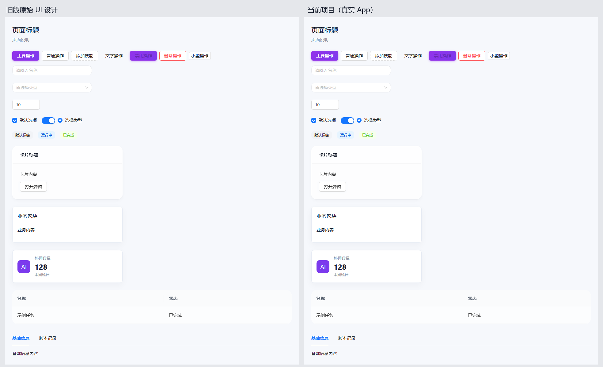

# 旧版完整 UI 设计对齐验收

日期：2026-11-03。状态：本轮修正完成，按旧项目实际设计系统验收。

## 修正原因

上一轮只接入v1部分样式并自定义蓝色ConfigProvider主题，遗漏了旧main.ts实际导入的design-system.css；因此按钮、输入、卡片、标签、表格和弹窗并不一致。该层并非废弃历史样式。

## 本次实现

- 4份旧design-system/v1 CSS按原字节复制，生产副本、冻结测试基线与用户指定旧工程SHA256一致。base.css保留旧index.css基础、字体、重置、滚动条、选择色及动画规则，只去除模块导入/Tailwind指令；当前没有依赖Tailwind工具类的页面。
- App删除自创主题Token，与旧App一样只设置中文locale，使用同版本Ant Design Vue4.2.6默认主题。生产与测试候选共用src/app/styles/index.css。
- 主按钮恢复#9333EA→#7C3AED紫渐变与旧阴影/hover；输入12px及紫色focus，Tag8px，Ant Card16px/24px/半透明/旧阴影，表格和Modal恢复原规则。
- 原生V1业务/统计卡保留8px/16px/白底，与Ant Card区分。工作台和模板统计卡改为旧V1MetricCard同构DOM，浏览器实测padding/radius/shadow/icon/value一致。
- 人事、管理、知识、客服和运营逐模块清理旧React色板及局部强制覆盖；标题按旧PageHeader24/700/1.3或V1PageShell22使用。气泡、头像、消息/输入间距、Markdown、证据和交付元素使用旧对应源规则。
- 品牌标记、导航文字、顶栏图标/头像/字体和1023px移动导航断点也对齐旧版，不增加旧版专属登录、通知或搜索业务。
- 独立审查发现的添加技能按钮蓝字/#a9cbff边框被真实业务页对照复现并移除。字段、动作、模型、API、流式状态和预算规则未改变。

## 对照方法与结果

参考侧用冻结旧源样式及同版本Ant Design Vue，候选侧挂载真实App→PlatformShell→ConfigProvider，未另造测试主题。默认测试使用仓库内冻结基线，不依赖旧工程绝对路径；UI_REFERENCE_ROOT可显式指向旧工程重验。

- 28个控件或部位，23项计算样式；含默认、hover、focus、disabled、Modal及实际业务虚线按钮，共878个属性/状态比对通过。
- 两张试件图均960×1135；样式属性一致。栅格图约0.0823%像素存在渲染差值，897像素中仅2像素的单通道差值超过3，未把截图宣称为字节级完全相同。
- HR原生统计卡另有真实业务DOM计算样式对照，通过。
- 41文件206项单元/组件测试通过；默认44项浏览器测试通过，包含132次三宽业务页面检查。
- 格式、ESLint、全量严格类型检查和生产构建通过。ESLint为0error/57条既有warning，构建保留Ant Design Vue入口分块大小提示，没有调阈值隐藏。
- 对上轮交付的业务实体/API/流/状态机文件按哈希核对，结果见business-contract-preservation.json，无变化。
- 本轮无真实生成、Embedding、rerank或其他付费调用；原有业务功能依旧按离线fixture/Mock验收。

## 图像证据

[旧版与当前控件并排图](controls-side-by-side.png)

[旧版控件](reference-controls.png) · [当前控件](candidate-controls.png) · [旧版弹窗](reference-modal.png) · [当前弹窗](candidate-modal.png)

[当前工作台](../2026-11-03-vue-migration/screenshots/hr-workbench-1440.png) · [当前知识库](../2026-11-03-vue-migration/screenshots/knowledge-list-1440.png) · [当前客服](../2026-11-03-vue-migration/screenshots/customer-service-1440.png)

## 范围说明

本轮复用的是完整UI设计，不把旧业务数据、菜单权限和接口迁入。参考工程只读；当前业务内容和可操作功能保留。上面的像素统计针对同内容控件试件，不表示不同业务内容的全部页面截图逐像素相同。

实施计划见docs/superpowers/plans/2026-11-03-旧版完整UI设计对齐-实施计划.md；各域源依据见hr-style.md、management-knowledge-style.md、chat-style.md。实时预览：<http://127.0.0.1:5192/>。
